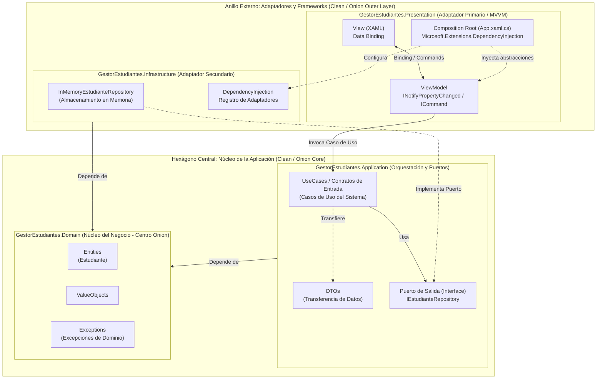

# 01. Arquitectura General del Sistema

## 1. Descripción del Proyecto

**GestorEstudiantesMVVM** es una aplicación de escritorio para Windows desarrollada en **C#** y **WPF (Windows Presentation Foundation)** sobre **.NET 9.0**. El sistema tiene como propósito gestionar el ciclo de vida académico básico de los estudiantes (registro, consulta, listado, búsqueda por matrícula o nombre, actualización y eliminación) almacenando inicialmente la información en memoria.

El **objetivo académico central** de este proyecto es demostrar cómo cuatro enfoques arquitectónicos y patrones de diseño de software ampliamente utilizados en la industria (**MVVM**, **Clean Architecture**, **Onion Architecture** y **Hexagonal Architecture**) no son mutuamente excluyentes, sino altamente complementarios cuando se integran de forma cohesiva dentro de una única solución limpia, mantenible, desacoplada y fácil de defender técnicamente.

---

## 2. Arquitecturas y Patrones Utilizados

En lugar de sobrecomplicar la solución duplicando capas, este proyecto unifica los cuatro enfoques asignando a cada uno el ámbito exacto donde aporta mayor valor:

1. **MVVM (Model - View - ViewModel):** Patrón arquitectónico específico para la capa de presentación (`GestorEstudiantes.Presentation`).
2. **Onion Architecture (Arquitectura en Cebolla):** Modelo estructural concéntrico que coloca al Dominio en el núcleo y organiza las dependencias hacia adentro.
3. **Clean Architecture (Arquitectura Limpia):** Filosofía de separación de responsabilidades y regla estricta de dependencia entre las capas concéntricas (Dominio, Aplicación, Infraestructura y Presentación).
4. **Hexagonal Architecture (Puertos y Adaptadores):** Mecanismo táctico mediante el cual el núcleo de aplicación interactúa con el mundo exterior a través de interfaces (Puertos) e implementaciones técnicas intercambiables (Adaptadores).

---

## 3. Función de Cada Arquitectura en la Solución

### A. MVVM (Enfoque en la Interfaz de Usuario)
Resuelve el acoplamiento dentro de la capa gráfica (`GestorEstudiantes.Presentation`):
- **View (`Views/`):** Archivos XAML y su *code-behind* mínimo. Define exclusivamente la estructura visual y se comunica mediante *Data Binding* y *Commands*.
- **ViewModel (`ViewModels/`):** Expone propiedades observables (`INotifyPropertyChanged`, `ObservableCollection<T>`) y comandos (`ICommand` / `RelayCommand`). Actúa como coordinador de estado visual y delega toda operación de negocio a los Casos de Uso de la capa `Application`. **No contiene reglas de negocio ni conoce repositorios concretos.**
- **Model (desde la perspectiva de MVVM):** Representado por los objetos de transferencia de datos (`DTOs`) o modelos de vista que provienen de la capa `Application`, manteniendo a la vista aislada de las entidades puras del dominio cuando corresponde.

### B. Onion Architecture (Enfoque en el Núcleo del Dominio)
Establece la topología de anillos concéntricos:
- El centro absoluto es `GestorEstudiantes.Domain` (Entidades, Value Objects, Excepciones de Dominio).
- El siguiente anillo es `GestorEstudiantes.Application` (Casos de Uso, DTOs, Puertos).
- El anillo externo lo conforman `GestorEstudiantes.Infrastructure` (Persistencia en memoria) y `GestorEstudiantes.Presentation` (WPF).
- **Regla fundamental:** Todo acoplamiento apunta hacia el centro. El núcleo no sabe qué base de datos existe ni si la interfaz es WPF, Web o Consola.

### C. Clean Architecture (Enfoque en la Regla de Dependencia y Casos de Uso)
Organiza el sistema alrededor de los **Casos de Uso** (`UseCases`) independientes de detalles técnicos:
- Separa las **Reglas de Negocio Empresariales** (`Domain`) de las **Reglas de Negocio de Aplicación** (`Application`).
- Garantiza que los casos de uso (registrar, buscar, actualizar, eliminar estudiante) puedan probarse de forma unitaria sin levantar ventanas WPF ni motores de base de datos.

### D. Hexagonal Architecture / Ports & Adapters (Enfoque en Contratos e Intercambiabilidad)
Define explícitamente cómo entran y salen los datos del hexágono central (`Domain` + `Application`):
- **Puertos de Entrada (Primary / Driving Ports):** Los contratos o casos de uso en `GestorEstudiantes.Application` que son consumidos por el adaptador primario (los ViewModels de WPF).
- **Puertos de Salida (Secondary / Driven Ports):** Interfaces definidas en `GestorEstudiantes.Application/Interfaces`, como `IEstudianteRepository`, que expresan *qué* necesita la aplicación del almacenamiento sin importar *cómo* se implemente.
- **Adaptadores Secundarios (Driven Adapters):** Clases concretas en `GestorEstudiantes.Infrastructure/Repositories`, como `InMemoryEstudianteRepository`, que implementan el puerto `IEstudianteRepository`.

---

## 4. Cómo se Complementan entre Sí

| Enfoque | Pregunta que responde en el proyecto | Ubicación principal |
| :--- | :--- | :--- |
| **Onion Architecture** | *¿Quién está en el centro y hacia dónde apuntan las capas?* | Estructura concéntrica centrada en `Domain`. |
| **Clean Architecture** | *¿Cómo aislamos los casos de uso de la UI y la persistencia?* | Separación entre `Domain`, `Application`, `Infrastructure` y `Presentation`. |
| **Hexagonal Architecture** | *¿Cómo conectamos la aplicación con la memoria o futura BD sin acoplarlos?* | Puerto `IEstudianteRepository` (`Application`) + Adaptador `InMemoryEstudianteRepository` (`Infrastructure`). |
| **MVVM** | *¿Cómo estructuramos internamente la capa visual WPF para que sea limpia?* | `Views`, `ViewModels` y `Commands` dentro de `Presentation`. |

---

## 5. Diagrama de Arquitectura General Integrada

El siguiente diagrama representa cómo los cuatro enfoques conviven armónicamente en los cuatro proyectos de la solución:

