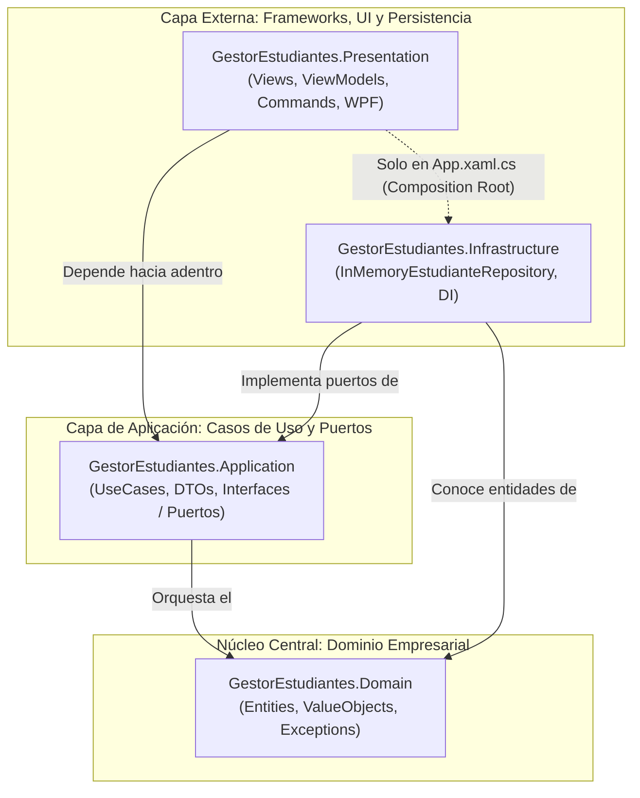

# 02. Estructura del Proyecto y Organización de la Solución

## 1. Organización General de la Solución

La solución `GestorEstudiantesMVVM.sln` está dividida en **cuatro proyectos independientes**, cada uno compilado como un ensamblado distinto (`.dll` o `.exe`) para que el propio compilador de C# haga cumplir las fronteras arquitectónicas:

1. `GestorEstudiantes.Domain` (Biblioteca de clases - `net9.0`)
2. `GestorEstudiantes.Application` (Biblioteca de clases - `net9.0`)
3. `GestorEstudiantes.Infrastructure` (Biblioteca de clases - `net9.0`)
4. `GestorEstudiantes.Presentation` (Aplicación de escritorio WPF - `net9.0-windows`)

Adicionalmente, cuenta con una carpeta `docs/` en la raíz de la solución que centraliza toda la documentación arquitectónica.

---

## 2. Árbol de Directorios de la Solución

```text
GestorEstudiantesMVVM/
│
├── GestorEstudiantesMVVM.sln
│
├── docs/
│   ├── 01_ARQUITECTURA_GENERAL.md
│   ├── 02_ESTRUCTURA_PROYECTO.md
│   ├── 03_DEPENDENCIAS.md
│   ├── 04_FLUJO_EJECUCION.md
│   ├── 05_DECISIONES_ARQUITECTONICAS.md
│   └── 06_PLAN_IMPLEMENTACION.md
│
├── GestorEstudiantes.Domain/
│   ├── GestorEstudiantes.Domain.csproj
│   ├── Entities/
│   ├── ValueObjects/
│   └── Exceptions/
│
├── GestorEstudiantes.Application/
│   ├── GestorEstudiantes.Application.csproj
│   ├── Interfaces/
│   ├── UseCases/
│   └── DTOs/
│
├── GestorEstudiantes.Infrastructure/
│   ├── GestorEstudiantes.Infrastructure.csproj
│   ├── Repositories/
│   └── DependencyInjection/
│
└── GestorEstudiantes.Presentation/
    ├── GestorEstudiantes.Presentation.csproj
    ├── App.xaml
    ├── App.xaml.cs
    ├── MainWindow.xaml
    ├── MainWindow.xaml.cs
    ├── Views/
    ├── ViewModels/
    ├── Commands/
    ├── Converters/
    └── Resources/
```

---

## 3. Responsabilidad Detallada de Cada Proyecto y Carpeta

### A. `GestorEstudiantes.Domain` (Núcleo del Negocio)
Es el corazón de la **Onion Architecture** y **Clean Architecture**. Contiene exclusivamente el conocimiento empresarial puro sobre los estudiantes y sus invariantes.
- **`Entities/`:** Contendrá la entidad principal `Estudiante` (con propiedades como Matrícula, Nombre, Apellido, Correo electrónico, Carrera) y su identidad de negocio.
- **`ValueObjects/`:** Contendrá objetos de valor inmutables si se requieren para encapsular conceptos con validación propia (por ejemplo, `CorreoElectronico` o `Matricula`).
- **`Exceptions/`:** Contendrá excepciones semánticas propias del negocio (por ejemplo, `DomainException`) para expresar violaciones a las reglas fundamentales sin depender de excepciones técnicas de infraestructura.
- **Restricción clave:** Cero dependencias hacia otros proyectos o paquetes NuGet externos.

### B. `GestorEstudiantes.Application` (Coordinación y Casos de Uso)
Orquesta las operaciones permitidas por el sistema y define los **Puertos** de la **Hexagonal Architecture**.
- **`Interfaces/`:** Define los contratos o puertos del sistema, destacando el puerto de salida `IEstudianteRepository` para las operaciones de almacenamiento y consulta, así como contratos de servicios de aplicación si fueran necesarios.
- **`UseCases/`:** Contendrá los casos de uso del sistema (registrar estudiante, consultar listado, buscar por matrícula/nombre, actualizar información, eliminar estudiante) y sus validaciones de aplicación previas.
- **`DTOs/`:** Objetos de transferencia de datos (`EstudianteDto`, etc.) que desacoplan las entidades internas del dominio respecto de lo que consume o envía la capa de presentación.

### C. `GestorEstudiantes.Infrastructure` (Detalles Técnicos y Adaptadores Secundarios)
Implementa los mecanismos técnicos concretos exigidos por los puertos de `Application`.
- **`Repositories/`:** Alojará los adaptadores secundarios de persistencia, específicamente `InMemoryEstudianteRepository`, que implementará `IEstudianteRepository` manteniendo una colección en memoria.
- **`DependencyInjection/`:** Contendrá la clase extensora de configuración (`InfrastructureServiceRegistration`) para registrar limpiamente los repositorios y adaptadores en el contenedor `IServiceCollection`.

### D. `GestorEstudiantes.Presentation` (Interfaz Gráfica WPF y MVVM)
Actúa como adaptador primario para la interacción con el usuario y como **Composition Root** (raíz de composición) donde se ensamblan todas las piezas al iniciar la aplicación.
- **`Views/`:** Ventanas (`Window`) y controles de usuario (`UserControl`) escritos en XAML.
- **`ViewModels/`:** Clases que implementan `INotifyPropertyChanged` (más una clase base `ViewModelBase`) para exponer el estado de la pantalla, colecciones `ObservableCollection<T>` y comandos enlazables.
- **`Commands/`:** Implementación reutilizable de `ICommand` (como `RelayCommand`) para capturar acciones del usuario en la vista sin escribir lógica en el *code-behind*.
- **`Converters/`:** Conversores de valores (`IValueConverter`) para transformar datos de los ViewModels a representaciones visuales en XAML cuando sea necesario.
- **`Resources/`:** Diccionarios de recursos XAML, estilos visuales, plantillas y activos gráficos.
- **`App.xaml` / `App.xaml.cs`:** Punto de entrada de la aplicación donde se configura `Microsoft.Extensions.DependencyInjection`.

---

## 4. Diagrama Conceptual de Clean Architecture y Onion Architecture


