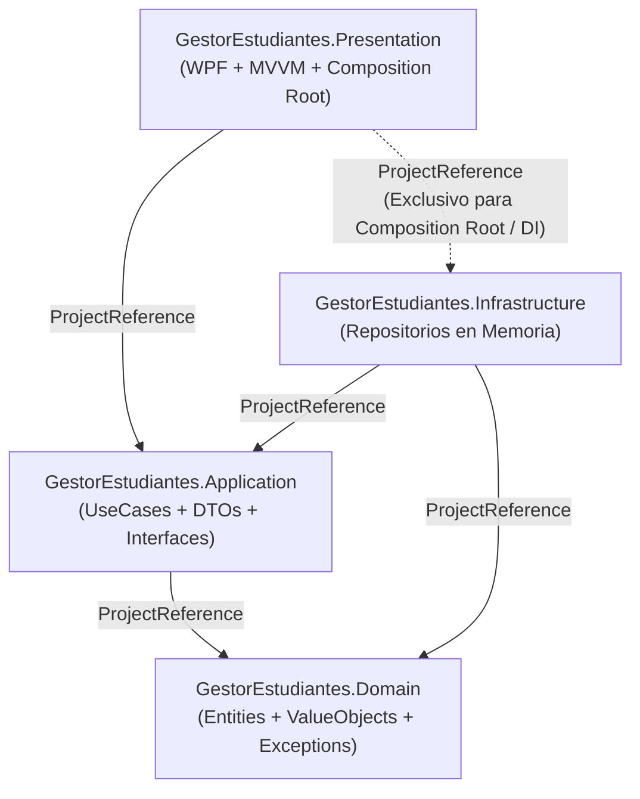
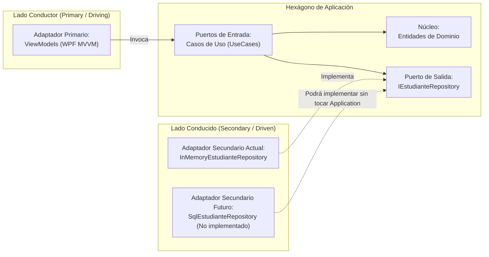

# 03. Dependencias entre Proyectos y Regla de Dependencia

## 1. Matriz de Referencias Permitidas

En **Clean Architecture** y **Onion Architecture**, el control estricto de las referencias entre proyectos (`.csproj`) es el mecanismo que impide que la lógica de negocio se contamine con detalles de interfaz gráfica o almacenamiento.

| Proyecto Origen | Referencia a `Domain` | Referencia a `Application` | Referencia a `Infrastructure` | Referencia a `Presentation` | Paquetes NuGet Externos |
| :--- | :---: | :---: | :---: | :---: | :--- |
| **`GestorEstudiantes.Domain`** | — | ❌ No | ❌ No | ❌ No | Ninguno |
| **`GestorEstudiantes.Application`** | ✅ Sí | — | ❌ No | ❌ No | Ninguno (o `DependencyInjection.Abstractions` si se requiere) |
| **`GestorEstudiantes.Infrastructure`** | ✅ Sí | ✅ Sí | — | ❌ No | `Microsoft.Extensions.DependencyInjection.Abstractions` |
| **`GestorEstudiantes.Presentation`** | ❌ No Directo* | ✅ Sí | ✅ Sí (Solo DI) | — | `Microsoft.Extensions.DependencyInjection` |

*\*Nota: `Presentation` interactúa con `Application` mediante casos de uso y DTOs. Aunque por transitividad de MSBuild existe visibilidad de ensamblados inferiores, arquitectónicamente los `ViewModels` solo consumen contratos y DTOs de `Application`.*

---

## 2. Dirección de las Dependencias e Inversión de Dependencias (DIP)

1. **Hacia el Centro:** Todas las dependencias de código fuente apuntan hacia las capas más internas (`Domain` no conoce a nadie; `Application` solo conoce a `Domain`).
2. **Principio de Inversión de Dependencias (DIP) entre `Application` e `Infrastructure`:**
   - En una arquitectura tradicional en capas, la capa de negocio llamaría directamente a la capa de datos (`Negocio -> Datos`).
   - En nuestra arquitectura **Clean / Onion / Hexagonal**, `Application` define la interfaz `IEstudianteRepository` (Puerto de Salida) y `Infrastructure` la implementa (`InMemoryEstudianteRepository`).
   - Por lo tanto, en tiempo de ejecución el flujo va de `Application` hacia `Infrastructure`, pero **la dependencia en tiempo de compilación se invierte**: `Infrastructure` depende de `Application`.

---

## 3. Diagrama de Dependencias entre Proyectos y Puertos/Adaptadores

### A. Diagrama de Referencias de Compilación (`.csproj`)

### B. Diagrama de Puertos y Adaptadores (Hexagonal Architecture)

---

## 4. Justificación Arquitectónica de Cada Referencia

### 1. ¿Por qué `Domain` no referencia a ningún proyecto?
Porque contiene las reglas fundamentales del negocio. Si `Domain` dependiera de otro proyecto o librería externa, cualquier cambio tecnológico obligaría a modificar las entidades centrales. Al no tener referencias, es 100% portable y perenne.

### 2. ¿Por qué `Application` referencia únicamente a `Domain`?
Porque los casos de uso necesitan orquestar las entidades de negocio (`Estudiante`) y aplicar las reglas del dominio, pero no deben saber *cómo* se guardan los datos en memoria ni *cómo* se pintan en una ventana XAML.

### 3. ¿Por qué `Infrastructure` referencia a `Application` y `Domain`?
Porque `Infrastructure` contiene la clase `InMemoryEstudianteRepository`, la cual debe implementar la interfaz `IEstudianteRepository` (ubicada en `Application`) y almacenar/recuperar instancias de la entidad `Estudiante` (ubicada en `Domain`).

### 4. ¿Por qué `Presentation` referencia a `Application` y a `Infrastructure`?
- **Referencia a `Application`:** Necesaria para que los `ViewModels` puedan invocar los Casos de Uso y utilizar los `DTOs`.
- **Referencia a `Infrastructure`:** En toda aplicación con Inyección de Dependencias existe un único punto llamado **Composition Root** (Raíz de Composición), que en WPF reside en `App.xaml.cs` dentro del proyecto ejecutable (`Presentation`). Para poder registrar en el contenedor de dependencias que `IEstudianteRepository` se resuelve mediante `InMemoryEstudianteRepository`, el punto de entrada debe invocar el método de registro expuesto por `Infrastructure`.
- **Regla de oro en `Presentation`:** Ningún `ViewModel`, `View` o `Command` debe instanciar ni importar clases del espacio de nombres `GestorEstudiantes.Infrastructure.Repositories`. Solo `App.xaml.cs` interactúa con `GestorEstudiantes.Infrastructure.DependencyInjection`.

---

## 5. Prevención de Dependencias Circulares

La topología forma un **Grafo Acíclico Dirigido (DAG)**:
- Nivel 0 (Base): `Domain`
- Nivel 1: `Application` (depende de Nivel 0)
- Nivel 2: `Infrastructure` (depende de Nivel 0 y Nivel 1)
- Nivel 3 (Raíz): `Presentation` (depende de Nivel 1 y Nivel 2)

Dado que ningún proyecto de un nivel inferior referencia jamás a un proyecto de un nivel superior, **es matemáticamente imposible que existan dependencias circulares** en la solución. Además, el compilador de .NET/MSBuild bloquea automáticamente cualquier intento de agregar referencias cíclicas entre archivos `.csproj`.
