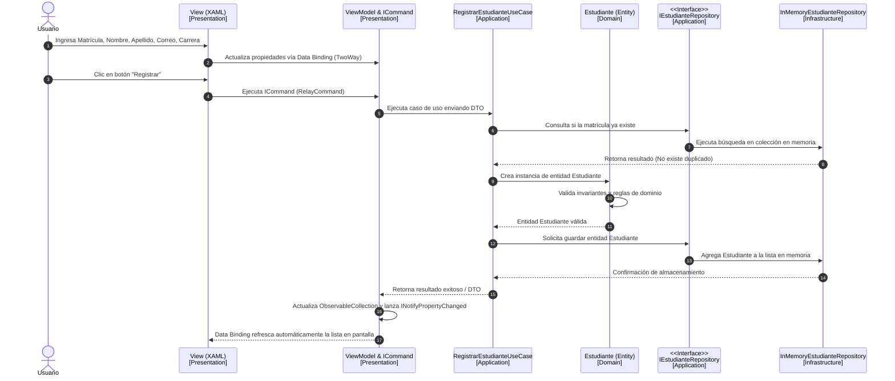

# 04. Flujo de Ejecución del Sistema

## 1. Descripción General del Recorrido de una Operación

En **GestorEstudiantesMVVM**, ninguna acción del usuario viaja directamente desde la pantalla hacia el almacenamiento en memoria. Toda operación atraviesa ordenada y limpiamente las capas siguiendo el flujo:

`View (XAML)` ➔ `Command / ViewModel (MVVM)` ➔ `UseCase (Application)` ➔ `Entity / Reglas (Domain)` ➔ `Puerto IEstudianteRepository (Application)` ➔ `Adaptador InMemoryEstudianteRepository (Infrastructure)`

Y retorna hacia la interfaz en sentido inverso a través de `DTOs` y notificaciones de enlace de datos (`INotifyPropertyChanged` / `ObservableCollection`).

---

## 2. Ejemplo Conceptual: Registro de un Estudiante

A continuación se describe paso a paso cómo ocurrirá conceptualmente el caso de uso **"Registrar Estudiante"** cuando se implemente en las fases posteriores:

### Paso 1: Interacción en la Vista (`GestorEstudiantes.Presentation/Views`)
1. El usuario escribe los datos del estudiante (Matrícula, Nombre, Apellido, Correo electrónico, Carrera) en los controles `TextBox` de la vista XAML.
2. Gracias al **Data Binding bidireccional (`TwoWay`)**, cada propiedad escrita actualiza automáticamente las propiedades enlazadas en el `ViewModel`.
3. El usuario presiona el botón **"Registrar"**, cuyo atributo `Command` está enlazado a una instancia de `ICommand` (`RelayCommand`) expuesta por el `ViewModel`.

### Paso 2: Coordinación en el ViewModel (`GestorEstudiantes.Presentation/ViewModels`)
1. El `RelayCommand` ejecuta el método manejador en el `ViewModel`.
2. El `ViewModel` **no aplica reglas de negocio de dominio ni toca la lista en memoria**. Su única responsabilidad es empaquetar los datos capturados de la pantalla dentro de un objeto de transferencia de datos (`EstudianteDto` o comando de entrada) e invocar al Caso de Uso correspondiente inyectado por constructor.

### Paso 3: Orquestación en el Caso de Uso (`GestorEstudiantes.Application/UseCases`)
1. El Caso de Uso recibe el DTO desde el `ViewModel`.
2. Ejecuta las validaciones de aplicación del caso de uso (por ejemplo, verificar a través del puerto `IEstudianteRepository` que no exista otro estudiante registrado con la misma matrícula).
3. Solicita la creación de la entidad de dominio `Estudiante`.

### Paso 4: Validación de Invariantes en el Dominio (`GestorEstudiantes.Domain/Entities`)
1. La entidad `Estudiante` (y sus posibles `ValueObjects`) valida sus reglas fundamentales de negocio (campos obligatorios, formato válido de correo electrónico, coherencia de la matrícula).
2. Si alguna regla fundamental se viola, el dominio lanza una excepción de dominio (`Exceptions/`).
3. Si todos los datos son válidos, se construye una instancia íntegra y consistente de `Estudiante`.

### Paso 5: Persistencia a través de Puerto y Adaptador (`Application` ➔ `Infrastructure`)
1. El Caso de Uso invoca el método del puerto de salida `IEstudianteRepository` pasándole la entidad `Estudiante`.
2. Gracias a la **Inyección de Dependencias** configurada al inicio de la aplicación, la llamada al puerto es atendida en tiempo de ejecución por el adaptador concreto `InMemoryEstudianteRepository` en `GestorEstudiantes.Infrastructure`.
3. `InMemoryEstudianteRepository` almacena al estudiante en su colección interna en memoria.

### Paso 6: Respuesta y Actualización Reactiva de la UI (`Application` ➔ `Presentation`)
1. El Caso de Uso confirma la operación (o devuelve el `EstudianteDto` creado) al `ViewModel`.
2. El `ViewModel` actualiza su `ObservableCollection<EstudianteDto>` y limpia las propiedades del formulario disparando `PropertyChanged`.
3. WPF detecta las notificaciones de `ObservableCollection` e `INotifyPropertyChanged` y refresca automáticamente la tabla de estudiantes y los campos de texto en la `View`, sin necesidad de manipular controles visuales desde código C#.

---

## 3. Diagrama de Secuencia: Flujo Conceptual de Registro de un Estudiante

---

## 4. Resumen de Responsabilidades en la Comunicación

| Capa / Componente | Qué envía | Qué recibe | Qué tiene prohibido hacer |
| :--- | :--- | :--- | :--- |
| **`View`** | Eventos de comando y valores enlazados (`Binding`). | Notificaciones `PropertyChanged` y cambios de `ObservableCollection`. | Invocar casos de uso o contener lógica de negocio en `.xaml.cs`. |
| **`ViewModel`** | `DTOs` o parámetros hacia los `UseCases`. | `DTOs` o resultados desde los `UseCases`. | Instanciar `InMemoryEstudianteRepository` o validar reglas profundas del dominio. |
| **`UseCase` (`Application`)** | Entidades `Estudiante` al puerto `IEstudianteRepository`. | `DTOs` desde `Presentation` y entidades desde `Domain` / `Repository`. | Referenciar clases de WPF (`Window`, `MessageBox`) o detalles de almacenamiento. |
| **`Entity` (`Domain`)** | Instancias válidas o excepciones de dominio. | Datos primitivos o `ValueObjects` para su construcción. | Llamar a repositorios o servicios externos. |
| **`Repository` (`Infrastructure`)** | Entidades almacenadas o recuperadas en memoria. | Llamadas a través del contrato `IEstudianteRepository`. | Contener reglas de negocio o lógica de presentación. |
