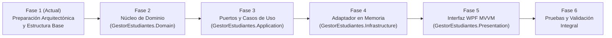

# 06. Plan de Implementación por Etapas

> [!IMPORTANT]
> Este documento define la hoja de ruta completa del proyecto **GestorEstudiantesMVVM**. Actualmente nos encontramos exclusivamente en la **Fase 1 (Preparación Arquitectónica y Estructuración Inicial)**. Las fases posteriores se ejecutarán únicamente bajo autorización explícita.

---

## 1. Etapas de Desarrollo y Orden Recomendado de Implementación

Siguiendo los principios de **Onion Architecture** y **Clean Architecture**, el desarrollo funcional debe construirse **desde el centro hacia afuera** (Inside-Out): primero el Dominio, luego la Aplicación, después la Infraestructura y finalmente la Presentación.

---

### Fase 1: Preparación Arquitectónica y Estructuración Inicial *(FASE ACTUAL - COMPLETADA)*
- Creación de la solución `GestorEstudiantesMVVM.sln`.
- Creación de los cuatro proyectos (`Domain`, `Application`, `Infrastructure`, `Presentation`).
- Configuración de referencias estrictas entre proyectos sin ciclos.
- Creación de la estructura de carpetas arquitectónicas.
- Configuración de `Microsoft.Extensions.DependencyInjection` y esqueleto base sin lógica de negocio.
- Generación de la documentación arquitectónica completa en `docs/`.
- Verificación de compilación limpia de toda la solución.

---

### Fase 2: Implementación del Núcleo de Dominio (`GestorEstudiantes.Domain`)
**Orden recomendado:**
1. **`Exceptions/`:** Implementar `DomainException` (y excepciones específicas como `EstudianteInvalidoException`) para representar errores de reglas de negocio.
2. **`ValueObjects/`:** Evaluar e implementar objetos de valor si aportan expresividad y encapsulamiento (por ejemplo, `CorreoElectronico` o `Matricula` con validación de formato invariante).
3. **`Entities/`:** Implementar la entidad `Estudiante` con sus propiedades de negocio:
   - `Matricula`
   - `Nombre`
   - `Apellido`
   - `CorreoElectronico`
   - `Carrera`
4. Incluir métodos de creación y actualización dentro de la entidad que garanticen que jamás pueda existir un `Estudiante` en estado inválido en el sistema.

---

### Fase 3: Definición de Puertos, DTOs y Casos de Uso (`GestorEstudiantes.Application`)
**Orden recomendado:**
1. **`Interfaces/` (Puerto de Salida):** Definir la interfaz `IEstudianteRepository` con las firmas necesarias para las operaciones previstas:
   - Registrar / agregar un estudiante.
   - Obtener todos los estudiantes.
   - Obtener un estudiante por su matrícula.
   - Buscar estudiantes por criterio (matrícula o nombre).
   - Actualizar la información de un estudiante.
   - Eliminar un estudiante por su matrícula.
   - Verificar existencia previa de matrícula.
2. **`DTOs/`:** Definir los objetos de transferencia de datos (`EstudianteDto`, peticiones de creación/actualización) para comunicar `Application` y `Presentation`.
3. **`UseCases/`:** Implementar los casos de uso o servicio de aplicación que coordinen las 7 funcionalidades previstas:
   - Validar información de entrada antes de registrarla o actualizarla.
   - Verificar reglas de unicidad (ej. que la matrícula no esté duplicada).
   - Invocar al dominio y al puerto `IEstudianteRepository`.

---

### Fase 4: Implementación del Adaptador de Infraestructura (`GestorEstudiantes.Infrastructure`)
**Orden recomendado:**
1. **`Repositories/`:** Implementar la clase `InMemoryEstudianteRepository` que cumpla el contrato `IEstudianteRepository`.
   - Utilizar una colección en memoria (`List<Estudiante>` o `Dictionary<string, Estudiante>`) segura y eficiente.
   - Opcionalmente incluir datos semilla (*seed data*) académicos si se solicita para facilitar las pruebas visuales.
2. **`DependencyInjection/`:** Completar el método extensor `AddInfrastructure()` para registrar `IEstudianteRepository` con su implementación `InMemoryEstudianteRepository` como `Singleton`.

---

### Fase 5: Implementación de la Capa de Presentación (`GestorEstudiantes.Presentation`)
**Orden recomendado:**
1. **`Commands/`:** Completar `RelayCommand` (implementación de `ICommand`) para enlazar acciones de botones.
2. **`ViewModels/`:**
   - Completar `ViewModelBase` (implementación de `INotifyPropertyChanged`).
   - Implementar `EstudianteViewModel` / `MainViewModel` con:
     - Propiedades enlazables para el formulario (`Matricula`, `Nombre`, `Apellido`, `CorreoElectronico`, `Carrera`, `TextoBusqueda`, `MensajeEstado`).
     - Colección `ObservableCollection<EstudianteDto>` para la tabla de estudiantes.
     - Comandos para Registrar, Buscar, Actualizar, Eliminar y Limpiar formulario.
3. **`Converters/` y `Resources/`:** Agregar estilos visuales limpios en XAML y conversores (si son necesarios para visibilidad o estados de edición).
4. **`Views/`:** Diseñar la interfaz en XAML (`MainWindow.xaml` o vistas modulares en `Views/`) utilizando `DataGrid`/`ListView`, `TextBox` y `Button` conectados exclusivamente mediante `{Binding}`.
5. **`App.xaml.cs` (Composition Root):** Conectar el registro de servicios de `Application`, `Infrastructure` y `ViewModels`, y resolver la ventana principal desde el contenedor de dependencias.

---

## 2. Resumen de Funcionalidades Previstas y su Trazabilidad Arquitectónica

| # | Funcionalidad Prevista | `Domain` | `Application` | `Infrastructure` | `Presentation (MVVM)` |
| :-: | :--- | :--- | :--- | :--- | :--- |
| 1 | **Validar información antes de registrarla** | Invariantes de `Estudiante` / `ValueObjects` | Validación en Caso de Uso (campos y unicidad) | — | Feedback visual en `ViewModel` / `View` |
| 2 | **Registrar estudiantes** | Construcción de `Estudiante` | Caso de Uso `RegistrarEstudiante` | `Add` en `InMemoryEstudianteRepository` | `RegistrarCommand` + Formulario XAML |
| 3 | **Consultar estudiantes** | Entidad `Estudiante` | Caso de Uso `ObtenerEstudiante` | Consulta en memoria | Selección en lista (`SelectedItem`) |
| 4 | **Mostrar un listado** | Entidad `Estudiante` | Caso de Uso `ListarEstudiantes` + `EstudianteDto` | Retorno de colección en memoria | `ObservableCollection` + `DataGrid` |
| 5 | **Buscar por matrícula o nombre** | — | Caso de Uso `BuscarEstudiantes` | Filtro por matrícula o nombre en memoria | `BuscarCommand` / `TextoBusqueda` |
| 6 | **Actualizar información** | Método de actualización en `Estudiante` | Caso de Uso `ActualizarEstudiante` | Actualización de elemento en memoria | `ActualizarCommand` + Modo edición |
| 7 | **Eliminar estudiantes** | — | Caso de Uso `EliminarEstudiante` | Remoción en `InMemoryEstudianteRepository` | `EliminarCommand` |

---

## 3. Plan de Pruebas Posteriores (Fase 6)

Una vez autorizada y completada la implementación funcional, se deberán realizar las siguientes pruebas de verificación:

1. **Pruebas de Reglas de Dominio y Validación:**
   - Intentar registrar un estudiante con matrícula, nombre, apellido, correo o carrera vacíos (debe ser rechazado con un mensaje claro).
   - Intentar registrar un correo electrónico con formato inválido.
   - Intentar registrar dos estudiantes con la misma matrícula (debe impedirse la duplicidad).
2. **Pruebas Funcionales del Ciclo CRUD en Memoria:**
   - **Alta:** Registrar estudiantes válidos y comprobar que aparecen inmediatamente en el listado (`ObservableCollection`).
   - **Consulta y Listado:** Seleccionar un estudiante del listado y verificar que sus datos se cargan en el panel de detalle/edición.
   - **Búsqueda:** Filtrar por coincidencia exacta o parcial de matrícula y de nombre/apellido; limpiar filtro y recuperar el listado completo.
   - **Actualización:** Modificar nombre, apellido, correo o carrera de un estudiante existente y comprobar su reflejo en la tabla.
   - **Eliminación:** Eliminar un estudiante registrado y verificar que desaparece de la lista en memoria.
3. **Pruebas de Auditoría Arquitectónica:**
   - Confirmar que ningún `ViewModel` tiene directivas `using GestorEstudiantes.Infrastructure;`.
   - Confirmar que los archivos `.xaml.cs` (*code-behind*) no contienen lógica de negocio ni llamadas al repositorio.
   - Confirmar que la solución compila sin advertencias ni errores en Visual Studio.
