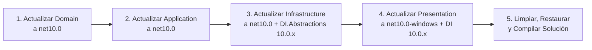

# 08. Guía de Preparación y Migración a .NET 10 LTS

> [!IMPORTANT]
> Este documento establece el procedimiento técnico oficial para preparar el entorno de desarrollo y migrar los cuatro proyectos de la solución **GestorEstudiantesMVVM** desde `.NET 8.0` hacia **`.NET 10.0 LTS`** (`net10.0` y `net10.0-windows`).
>
> **Estado actual:** Los archivos `.csproj` se mantienen intactos en `net8.0` / `net8.0-windows` hasta que el entorno de desarrollo cuente con el SDK de .NET 10 y Visual Studio 2026 instalados y verificados.

---

## 1. Diagnóstico del Entorno Actual vs. Requisitos de .NET 10 LTS

| Componente | Estado Actual Verificado en el Equipo | Requisito Oficial para .NET 10 LTS | Estado |
| :--- | :--- | :--- | :---: |
| **Sistema Operativo** | Windows (x64) | Windows 10 (v22H2+) o Windows 11 (x64 / ARM64) | ✅ Compatible |
| **IDE (Visual Studio)** | Visual Studio Community 2022 (`v17.14.37`) | **Visual Studio 2026 (`v18.0` o superior)** | ⚠️ Requiere instalación |
| **.NET SDK** | `9.0.316` | **.NET 10.0 SDK (`10.0.100` o superior)** | ⚠️ Requiere instalación |
| **Runtime de Escritorio WPF** | `Microsoft.WindowsDesktop.App` hasta `9.0.18` | **`Microsoft.WindowsDesktop.App 10.0.x`** (incluido con el SDK 10.0) | ⚠️ Requiere instalación |
| **Lenguaje C#** | C# 12 / C# 13 | **C# 14** (habilitado por defecto en `net10.0`) | ⚠️ Se activará con el SDK 10.0 |

---

## 2. Requisitos de Instalación y Componentes de Visual Studio

### A. Requisitos del Sistema y Herramientas Base
1. **Visual Studio 2026 (v18.0 o superior) — Edición Community, Professional o Enterprise:**
   - Microsoft establece **Visual Studio 2026 (`v18.0+`)** como el entorno de desarrollo integrado con soporte oficial para el diseñador XAML, depuración, Hot Reload y plantillas dirigidas a `net10.0` y `net10.0-windows`.
   - Visual Studio 2026 puede instalarse **en paralelo (*Side-by-Side*)** con Visual Studio 2022 `17.14.37` sin conflictos, o bien a través del **Visual Studio Installer** actualizado.

### B. Cargas de Trabajo (Workloads) y Componentes Individuales Necesarios en Visual Studio Installer
Al instalar o modificar **Visual Studio 2026**, debes asegurarte de marcar los siguientes elementos:

1. **Pestaña "Cargas de trabajo" (*Workloads*):**
   - ✅ **Desarrollo de escritorio de .NET** (*`.NET desktop development`* — ID: `Microsoft.VisualStudio.Workload.ManagedDesktop`).
2. **Panel lateral "Detalles de instalación" (*Installation details*) dentro de la carga de escritorio:**
   - ✅ **Herramientas de desarrollo de .NET Desktop** (*`.NET desktop development tools`*).
   - ✅ **SDK de .NET 10.0 (Long Term Support)** (*`.NET 10.0 Runtime / SDK`*).
   - ✅ **Depurador de diagnóstico y creación de perfiles de C# y Visual Basic** (incluye soporte para XAML Hot Reload).

### C. Instalación Independiente del SDK de .NET 10 (Alternativa o Complemento por CLI)
Si deseas instalar el SDK directamente desde el paquete oficial de Microsoft o mediante `winget`:
- **Paquete oficial:** `Microsoft.DotNet.SDK.10` (64-bit `win-x64`).
- Incluye automáticamente:
  - `.NET 10.0 SDK` (`10.0.1xx` / `10.0.2xx`).
  - `.NET Runtime 10.0.x` (`Microsoft.NETCore.App`).
  - `ASP.NET Core Runtime 10.0.x` (`Microsoft.AspNetCore.App`).
  - **`.NET Desktop Runtime 10.0.x` (`Microsoft.WindowsDesktop.App`)** — Indispensable para compilar y ejecutar **WPF**.

---

## 3. Versiones Recomendadas y Compatibilidad de Paquetes NuGet

### Evaluación de `Microsoft.Extensions.DependencyInjection` con `.NET 10.0`

| Paquete NuGet | Proyecto que lo Referencia | Versión Actual (`.NET 8`) | Versión Recomendada para `.NET 10 LTS` | Compatibilidad con `net10.0` |
| :--- | :--- | :---: | :---: | :--- |
| `Microsoft.Extensions.DependencyInjection.Abstractions` | `GestorEstudiantes.Infrastructure` | `8.0.2` | **`10.0.0`** (o última `10.0.x`) | ✅ **100% Compatible.** Las versiones `8.0.x` funcionan en `net10.0` por compatibilidad ascendente, pero al migrar a `net10.0` se recomienda actualizar a la serie `10.0.x` para alinear el ciclo de vida LTS y aprovechar las optimizaciones nativas de `net10.0`. |
| `Microsoft.Extensions.DependencyInjection` | `GestorEstudiantes.Presentation` | `8.0.1` | **`10.0.0`** (o última `10.0.x`) | ✅ **100% Compatible.** Mantiene intactas las APIs utilizadas en `App.xaml.cs` (`ServiceCollection`, `AddSingleton`, `AddTransient`, `BuildServiceProvider`, `GetRequiredService`). |

> [!TIP]
> **Ausencia de cambios disruptivos (Breaking Changes) en DI:** El código actual de `InfrastructureServiceRegistration.cs` y `App.xaml.cs` no requiere modificar ni una sola línea de C# al actualizar `Microsoft.Extensions.DependencyInjection` de la versión `8.0.x` a la versión `10.0.x`.

---

## 4. Análisis de Compatibilidad con WPF en .NET 10

Al migrar una aplicación WPF con patrón MVVM desde `net8.0-windows` hacia `net10.0-windows`, se deben tener en cuenta los siguientes puntos técnicos:

1. **Compatibilidad total de APIs base de MVVM y XAML:**
   - `System.Windows.Application`, `System.Windows.Window`, `INotifyPropertyChanged`, `ObservableCollection<T>`, `ICommand` y `CommandManager.RequerySuggested` funcionan de manera idéntica en `.NET 10.0`.
   - Ninguno de los archivos de `GestorEstudiantes.Presentation` (`App.xaml`, `MainWindow.xaml`, `ViewModelBase.cs`, `RelayCommand.cs`) sufre incompatibilidades.
2. **Target Framework Moniker (TFM) obligatorio para WPF:**
   - En `.NET 10`, los proyectos que utilizan `<UseWPF>true</UseWPF>` **deben** seguir especificando el sufijo de plataforma `-windows` (`<TargetFramework>net10.0-windows</TargetFramework>`), mientras que las bibliotecas de clases puras (`Domain`, `Application`, `Infrastructure`) deben usar `<TargetFramework>net10.0</TargetFramework>`.
3. **Diseñador XAML de Visual Studio:**
   - Si intentas abrir un proyecto con `<TargetFramework>net10.0-windows</TargetFramework>` en Visual Studio 2022 (`17.14.37`), el diseñador visual de XAML no podrá cargar la vista previa y MSBuild reportará el error `NETSDK1045`. Por ello es indispensable abrir la solución en **Visual Studio 2026 (`18.0+`)** una vez realizada la migración.
4. **Formato del Archivo de Solución (`.sln`):**
   - Visual Studio 2026 soporta tanto el formato clásico `.sln` (`Format Version 12.00`, que utiliza actualmente `GestorEstudiantesMVVM.sln`) como el nuevo formato `.slnx`. Conservar `GestorEstudiantesMVVM.sln` en formato `12.00` garantiza compatibilidad total y transparente.

---

## 5. Procedimiento Paso a Paso de Actualización del Entorno

### Paso 1: Instalar Visual Studio 2026 y el SDK de .NET 10.0
1. Abre **Visual Studio Installer** (o descarga el instalador de **Visual Studio 2026 Community** desde el portal oficial de Microsoft).
2. Selecciona **Visual Studio Community 2026 (`18.0+`)**.
3. Marca la carga de trabajo **Desarrollo de escritorio de .NET** y verifica en el panel lateral que esté seleccionado **.NET 10.0 (LTS) SDK**.
4. Alternativamente, para instalar el SDK de .NET 10 desde una terminal de Windows con permisos de administrador:
   ```powershell
   winget install Microsoft.DotNet.SDK.10
   ```
5. Reinicia cualquier terminal abierta o instancia de Visual Studio para que las variables de entorno (`PATH`) reconozcan el nuevo SDK.

---

## 6. Verificaciones del Entorno mediante CLI y Visual Studio

Antes de modificar cualquier archivo `.csproj`, ejecuta los siguientes comandos en PowerShell para confirmar que `.NET 10` está listo:

### A. Verificación mediante CLI (`dotnet`)

1. **Comprobar que el SDK `10.0.xxx` aparece listado:**
   ```powershell
   dotnet --list-sdks
   ```
   *Salida esperada:* Debe aparecer una línea similar a `10.0.100 [C:\Program Files\dotnet\sdk]` (o versión `10.0.xxx` superior).

2. **Comprobar que el Runtime de Escritorio de Windows (WPF) `10.0.x` está instalado:**
   ```powershell
   dotnet --list-runtimes
   ```
   *Salida esperada:* Deben figurar tanto `Microsoft.NETCore.App 10.0.x` como **`Microsoft.WindowsDesktop.App 10.0.x`**.

3. **Comprobar la versión activa del comando `dotnet`:**
   ```powershell
   dotnet --version
   ```
   *Salida esperada:* `10.0.xxx`.

### B. Verificación en Visual Studio 2026
1. Abre **Visual Studio 2026**.
2. Ve al menú **Ayuda > Acerca de Microsoft Visual Studio** (*Help > About Microsoft Visual Studio*) y confirma que la versión sea **`18.0` o superior**.
3. Abre `GestorEstudiantesMVVM.sln`, haz clic derecho sobre `GestorEstudiantes.Domain` > **Propiedades** (*Properties*) y verifica que en el desplegable **Plataforma de destino** (*Target framework*) aparezca la opción **.NET 10.0 (Long Term Support)**.

---

## 7. Procedimiento de Migración de los Cuatro Proyectos

Una vez verificada la instalación del SDK 10.0 y autorizado el cambio, la migración de la solución se realiza en cuatro pasos exactos sobre los archivos `.csproj`:



### 1. `GestorEstudiantes.Domain/GestorEstudiantes.Domain.csproj`
Cambiar `<TargetFramework>` de `net8.0` a `net10.0`:
```xml
<PropertyGroup>
  <TargetFramework>net10.0</TargetFramework>
  <ImplicitUsings>enable</ImplicitUsings>
  <Nullable>enable</Nullable>
  <RootNamespace>GestorEstudiantes.Domain</RootNamespace>
  <AssemblyName>GestorEstudiantes.Domain</AssemblyName>
</PropertyGroup>
```

### 2. `GestorEstudiantes.Application/GestorEstudiantes.Application.csproj`
Cambiar `<TargetFramework>` de `net8.0` a `net10.0`:
```xml
<PropertyGroup>
  <TargetFramework>net10.0</TargetFramework>
  <ImplicitUsings>enable</ImplicitUsings>
  <Nullable>enable</Nullable>
  <RootNamespace>GestorEstudiantes.Application</RootNamespace>
  <AssemblyName>GestorEstudiantes.Application</AssemblyName>
</PropertyGroup>
```

### 3. `GestorEstudiantes.Infrastructure/GestorEstudiantes.Infrastructure.csproj`
Cambiar `<TargetFramework>` a `net10.0` y actualizar la versión del paquete `Microsoft.Extensions.DependencyInjection.Abstractions` a `10.0.0` (o la versión `10.0.x` estable más reciente):
```xml
<PropertyGroup>
  <TargetFramework>net10.0</TargetFramework>
  <ImplicitUsings>enable</ImplicitUsings>
  <Nullable>enable</Nullable>
  <RootNamespace>GestorEstudiantes.Infrastructure</RootNamespace>
  <AssemblyName>GestorEstudiantes.Infrastructure</AssemblyName>
</PropertyGroup>

<ItemGroup>
  <PackageReference Include="Microsoft.Extensions.DependencyInjection.Abstractions" Version="10.0.0" />
</ItemGroup>
```

### 4. `GestorEstudiantes.Presentation/GestorEstudiantes.Presentation.csproj`
Cambiar `<TargetFramework>` a `net10.0-windows` y actualizar la versión del paquete `Microsoft.Extensions.DependencyInjection` a `10.0.0` (o la versión `10.0.x` estable más reciente):
```xml
<PropertyGroup>
  <OutputType>WinExe</OutputType>
  <TargetFramework>net10.0-windows</TargetFramework>
  <Nullable>enable</Nullable>
  <ImplicitUsings>enable</ImplicitUsings>
  <UseWPF>true</UseWPF>
  <RootNamespace>GestorEstudiantes.Presentation</RootNamespace>
  <AssemblyName>GestorEstudiantes.Presentation</AssemblyName>
</PropertyGroup>

<ItemGroup>
  <PackageReference Include="Microsoft.Extensions.DependencyInjection" Version="10.0.0" />
</ItemGroup>
```

---

## 8. Procedimiento de Compilación y Pruebas Posteriores a la Migración

Una vez aplicados los cambios en los cuatro archivos `.csproj`, se deberán ejecutar las siguientes verificaciones en orden:

1. **Limpieza de artefactos previos (`net8.0`):**
   ```powershell
   dotnet clean GestorEstudiantesMVVM.sln
   ```
2. **Restauración de paquetes NuGet para `.NET 10.0`:**
   ```powershell
   dotnet restore GestorEstudiantesMVVM.sln
   ```
3. **Compilación completa de la solución:**
   ```powershell
   dotnet build GestorEstudiantesMVVM.sln --configuration Debug
   ```
   *Criterio de aceptación:*
   - Generación exitosa de:
     - `GestorEstudiantes.Domain\bin\Debug\net10.0\GestorEstudiantes.Domain.dll`
     - `GestorEstudiantes.Application\bin\Debug\net10.0\GestorEstudiantes.Application.dll`
     - `GestorEstudiantes.Infrastructure\bin\Debug\net10.0\GestorEstudiantes.Infrastructure.dll`
     - `GestorEstudiantes.Presentation\bin\Debug\net10.0-windows\GestorEstudiantes.Presentation.dll` (y `.exe`)
   - **`0 Advertencia(s), 0 Errores`**.
4. **Prueba de arranque del Composition Root y Ventana WPF:**
   - Ejecutar el proyecto `GestorEstudiantes.Presentation` desde Visual Studio 2026 (`F5`) o mediante `dotnet run --project GestorEstudiantes.Presentation`.
   - Comprobar que `App.xaml.cs` construye el contenedor `ServiceProvider`, registra `InMemoryEstudianteRepository` como `IEstudianteRepository`, inyecta `MainViewModel` en `MainWindow` y despliega la ventana inicial sin excepciones en tiempo de ejecución.
