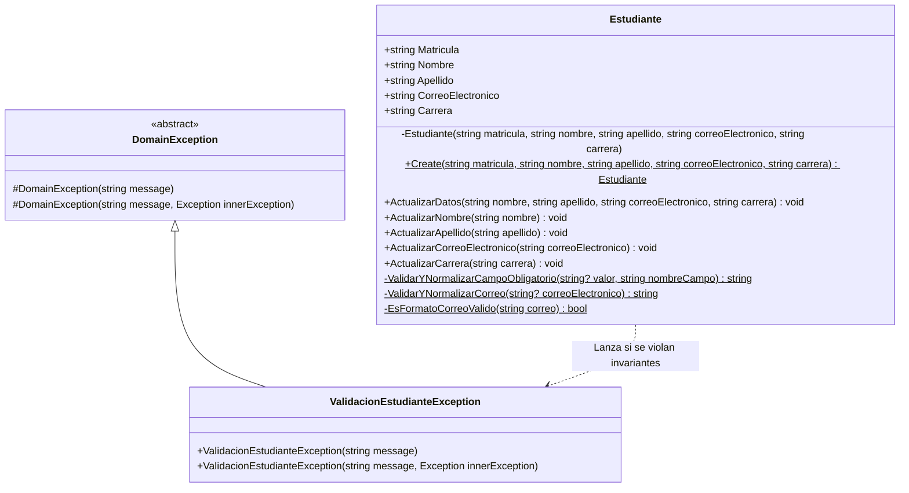

# 09. Fase 2 — Implementación de la Capa Domain (`GestorEstudiantes.Domain`)

## 1. Objetivo de la Capa Domain

La capa **`GestorEstudiantes.Domain`** constituye el núcleo central de la solución siguiendo los principios de **Onion Architecture** y **Clean Architecture**. Su objetivo exclusivo es encapsular las entidades fundamentales del negocio, sus reglas invariantes, su comportamiento intrínseco y las excepciones semánticas del dominio, manteniéndose **100% independiente** de cualquier tecnología externa, interfaz gráfica (WPF/XAML), framework de inyección de dependencias o mecanismo de persistencia (memoria o base de datos).

---

## 2. Entidad `Estudiante`

La entidad [Estudiante.cs](file:///c:/Users/Jari_/Music/GestorEstudiantesMVVM/GestorEstudiantes.Domain/Entities/Estudiante.cs) modela al sujeto principal del sistema académico. Se ha diseñado como un **modelo de dominio rico** (*Rich Domain Model*) y no como un modelo anémico (simples propiedades con `get; set;` públicos sin reglas), garantizando que una instancia de `Estudiante` jamás pueda existir en un estado inválido desde su creación ni a lo largo de su ciclo de vida.



---

## 3. Propiedades y Responsabilidades

| Propiedad | Tipo | Accesibilidad de Lectura | Accesibilidad de Escritura | Responsabilidad en el Dominio |
| :--- | :---: | :---: | :---: | :--- |
| **`Matricula`** | `string` | `public get` | Solo en constructor privado (sin `set`) | Identificador académico de negocio del estudiante. **Inmutable** tras su creación. |
| **`Nombre`** | `string` | `public get` | `private set` | Nombre(s) de pila del estudiante, normalizado y validado. |
| **`Apellido`** | `string` | `public get` | `private set` | Apellido(s) del estudiante, normalizado y validado. |
| **`CorreoElectronico`** | `string` | `public get` | `private set` | Dirección de contacto electrónico con formato válido verificado. |
| **`Carrera`** | `string` | `public get` | `private set` | Programa académico o carrera en la que está inscrito el estudiante. |

---

## 4. Reglas de Negocio Implementadas

1. **Matrícula:**
   - Es obligatoria (no puede ser `null`, cadena vacía `""` ni contener únicamente espacios en blanco).
   - Se normaliza automáticamente aplicando `.Trim()` para eliminar espacios al inicio y al final.
   - Es estrictamente **inmutable** una vez creado el estudiante (propiedad `get`-only sin ningún método de modificación).
2. **Nombre:**
   - Es obligatorio (no puede ser `null`, vacío ni solo espacios).
   - Se normaliza eliminando espacios sobrantes al inicio y al final (`.Trim()`).
3. **Apellido:**
   - Es obligatorio (no puede ser `null`, vacío ni solo espacios).
   - Aplica exactamente la misma regla de normalización (`.Trim()`) que el nombre.
4. **Correo Electrónico:**
   - Es obligatorio y se normaliza eliminando espacios en los extremos (`.Trim()`).
   - Debe cumplir un formato de correo electrónico válido y equilibrado:
     - Sin espacios intermedios ni caracteres de control.
     - Exactamente un símbolo `@` que separe una parte local no vacía y un dominio de al menos 3 caracteres.
     - La parte local no puede iniciar ni terminar con punto (`.`), ni contener puntos consecutivos (`..`).
     - El dominio debe incluir al menos un punto separador (`.`), sin puntos al inicio, al final ni puntos consecutivos (`..`).
     - Permite direcciones académicas e institucionales legítimas (subdominios como `alumno@campus.universidad.edu.do`, etiquetas `+`, guiones `-` y guiones bajos `_`).
5. **Carrera:**
   - Es obligatoria (no puede ser `null`, vacía ni solo espacios).
   - Se normaliza eliminando espacios al inicio y al final (`.Trim()`).

---

## 5. Estrategia de Validación (Principio DRY)

Para evitar la duplicación de código entre la creación y las actualizaciones de la entidad:
- Se centralizó la validación de campos de texto obligatorios y su normalización en el método privado estático `ValidarYNormalizarCampoObligatorio(string? valor, string nombreCampo)`.
- Se centralizó la validación y normalización del correo electrónico en `ValidarYNormalizarCorreo(string? correoElectronico)` apoyado por `EsFormatoCorreoValido(string correo)`.
- Tanto el método de fábrica `Estudiante.Create(...)` como los métodos de modificación (`ActualizarDatos`, `ActualizarNombre`, `ActualizarApellido`, `ActualizarCorreoElectronico`, `ActualizarCarrera`) reutilizan exactamente estos mismos métodos privados.

---

## 6. Encapsulamiento y Protección de Invariantes

1. **Constructor Privado y Método Estático `Create`:**
   - El constructor de `Estudiante` es `private`. Ninguna capa externa puede hacer `new Estudiante(...)` saltándose las reglas.
   - El único punto de entrada para instanciar un estudiante es `Estudiante.Create(...)`, el cual valida y normaliza todos los parámetros antes de invocar al constructor privado.
2. **Ausencia de Setters Públicos:**
   - Ninguna propiedad tiene `public set`. Cualquier intento de hacer `estudiante.Nombre = ""` o `estudiante.Matricula = "OTRA"` es rechazado en tiempo de compilación por C#.
3. **Atomicidad en `ActualizarDatos`:**
   - En `ActualizarDatos(nombre, apellido, correoElectronico, carrera)`, primero se validan y normalizan **todos** los valores en variables locales y solo si los cuatro son válidos se asignan a las propiedades de la entidad. Si el tercer o cuarto parámetro falla, la entidad conserva intacto su estado anterior sin quedar parcialmente modificada.

---

## 7. Excepciones del Dominio

Se implementó una jerarquía concisa y expresiva en `GestorEstudiantes.Domain/Exceptions`:

1. **[DomainException.cs](file:///c:/Users/Jari_/Music/GestorEstudiantesMVVM/GestorEstudiantes.Domain/Exceptions/DomainException.cs):**
   - Clase base `abstract` que hereda de `System.Exception`. Permite que las capas superiores (`Application` o `Presentation`) puedan capturar cualquier error de negocio del dominio de forma polimórfica.
2. **[ValidacionEstudianteException.cs](file:///c:/Users/Jari_/Music/GestorEstudiantesMVVM/GestorEstudiantes.Domain/Exceptions/ValidacionEstudianteException.cs):**
   - Clase `sealed` que hereda de `DomainException`. Se lanza cuando cualquiera de las reglas de validación o invariantes de `Estudiante` es vulnerada, proporcionando un mensaje descriptivo y claro en español listo para ser tratado por las capas exteriores.
   - Siguiendo el principio de simplicidad arquitectónica, se evitó crear una proliferación innecesaria de clases de excepción por cada campo individual.

---

## 8. Justificación Arquitectónica: ¿Por qué la Unicidad de Matrícula Corresponde a `Application` y NO a `Domain`?

Una pregunta clásica en defensas académicas de **Clean Architecture**, **Onion Architecture** y **DDD (Domain-Driven Design)** es dónde debe validarse que no existan dos estudiantes con la misma matrícula:

1. **Invariante Intra-Entidad (`Domain`) vs. Regla de Conjunto / Persistencia (`Application`):**
   - Una instancia de `Estudiante` en `Domain` solo se conoce a sí misma en memoria. Puede saber si su propia matrícula está vacía (`""`), pero **no tiene forma de saber qué otros estudiantes existen almacenados** sin consultar al repositorio (`IEstudianteRepository`).
2. **Preservación de la Pureza del Dominio:**
   - `IEstudianteRepository` es un puerto definido en `GestorEstudiantes.Application`. Si `Estudiante` intentara consultar un repositorio para verificar duplicados, `Domain` tendría que depender de contratos de persistencia o servicios externos, rompiendo el aislamiento del núcleo en **Onion Architecture**.
3. **Responsabilidad en la Fase 3 (`Application`):**
   - Por lo tanto, `Domain` garantiza que toda matrícula tenga un valor válido e inmutable, mientras que el Caso de Uso `RegistrarEstudiante` en `GestorEstudiantes.Application` (que sí tiene inyectado el puerto `IEstudianteRepository`) será el responsable de verificar que la matrícula no esté previamente registrada antes de persistir la entidad.

---

## 9. Pruebas Unitarias Realizadas (`GestorEstudiantes.Domain.Tests`)

Se creó el proyecto de pruebas independiente [GestorEstudiantes.Domain.Tests.csproj](file:///c:/Users/Jari_/Music/GestorEstudiantesMVVM/GestorEstudiantes.Domain.Tests/GestorEstudiantes.Domain.Tests.csproj) utilizando **xUnit** sobre `.NET 9.0` (`net9.0`).

Tras las correcciones controladas de la auditoría complementaria, la suite en [EstudianteTests.cs](file:///c:/Users/Jari_/Music/GestorEstudiantesMVVM/GestorEstudiantes.Domain.Tests/Entities/EstudianteTests.cs) cuenta con **18 métodos de prueba** (`[Fact]` y `[Theory]`) que ejecutan un total de **47 casos de prueba unitarios**:

- **Creación y Normalización:**
  - `Create_ConDatosValidos_CreaEstudianteCorrectamente` (1 caso)
  - `Create_ConEspaciosAlInicioYFinal_NormalizaTodosLosCampos` (1 caso)
  - `Create_ConFormatosDeCorreoLegitimos_PermiteCreacion` (3 casos con `[Theory]`)
- **Rechazo de Datos Inválidos en Creación:**
  - `Create_ConMatriculaVaciaONula_LanzaValidacionEstudianteException` (4 casos: `null`, `""`, `"   "`, `"\t\r\n"`)
  - `Create_ConNombreVacioONulo_LanzaValidacionEstudianteException` (3 casos)
  - `Create_ConApellidoVacioONulo_LanzaValidacionEstudianteException` (3 casos)
  - `Create_ConCorreoInvalido_LanzaValidacionEstudianteException` (16 casos de formatos inválidos, incluyendo puntos extremos y consecutivos tanto en la parte local como en el dominio: `usuario..nombre@dominio.com`, `.usuario@dominio.com`, `usuario.@dominio.com`)
  - `Create_ConCarreraVaciaONula_LanzaValidacionEstudianteException` (3 casos)
- **Modificaciones, Atomicidad y Protección de Estado:**
  - `ActualizarNombre_ConNombreValido_ActualizaYNormalizaCorrectamente` (1 caso)
  - `ActualizarApellido_ConApellidoValido_ActualizaYNormalizaCorrectamente` (1 caso)
  - `ActualizarCorreoElectronico_ConCorreoValido_ActualizaYNormalizaCorrectamente` (1 caso)
  - `ActualizarCarrera_ConCarreraValida_ActualizaYNormalizaCorrectamente` (1 caso)
  - `ActualizarDatos_ConDatosValidos_ActualizaPropiedadesModificablesYConservaMatricula` (1 caso)
  - `Modificaciones_ConValoresInvalidos_LanzanExcepcionYNoAlteranEstadoPrevio` (1 caso)
  - `ActualizarDatos_CuandoFallaCualquierParametro_EsAtomicoYConservaEstadoOriginal` (4 casos con `[Theory]`: fallo en nombre, apellido, correo electrónico o carrera)
  - `ModificacionesIndividuales_ConValoresNulos_LanzanExcepcionYConservanEstadoOriginal` (1 caso verificando `null!` en los 4 métodos individuales)
- **Encapsulamiento y Excepciones del Dominio:**
  - `Estudiante_EncapsulamientoEInmutabilidadDeMatricula_NoPermiteModificacionExterna` (1 caso)
  - `ValidacionEstudianteException_ConInnerException_ConservaMensajeYExcepcionOriginal` (1 caso)

**Resultado de Compilación y Ejecución de Pruebas:**
- `dotnet restore GestorEstudiantesMVVM.sln` -> Restauración exitosa.
- `dotnet test GestorEstudiantesMVVM.sln` -> **47 pruebas ejecutadas, 47 superadas, 0 fallidas.**
- `dotnet build GestorEstudiantesMVVM.sln` -> **Compilación correcta (0 advertencias, 0 errores).**

---

## 10. Ejemplos de Creación y Modificación de un Estudiante

### A. Creación controlada y normalizada
```csharp
using GestorEstudiantes.Domain.Entities;

// Los espacios sobrantes al inicio y al final se normalizan automáticamente
Estudiante estudiante = Estudiante.Create(
    matricula: "  2026-0105  ",
    nombre: "  Laura Sofía ",
    apellido: " Hernández ",
    correoElectronico: " laura.hernandez@universidad.edu ",
    carrera: " Ingeniería de Software ");

// Propiedades resultantes:
// estudiante.Matricula         -> "2026-0105" (Inmutable)
// estudiante.Nombre            -> "Laura Sofía"
// estudiante.Apellido          -> "Hernández"
// estudiante.CorreoElectronico -> "laura.hernandez@universidad.edu"
// estudiante.Carrera           -> "Ingeniería de Software"
```

### B. Modificación válida de datos
```csharp
// Actualización integral de los datos modificables (la matrícula no puede alterarse)
estudiante.ActualizarDatos(
    nombre: "Laura Sofía",
    apellido: "Hernández Mora",
    correoElectronico: "l.hernandez@posgrado.universidad.edu",
    carrera: "Maestría en Arquitectura de Software");

// O actualización individual de un atributo específico:
estudiante.ActualizarCarrera("Ciencias de la Computación");
```

### C. Intento de operación inválida (captura de excepción de dominio)
```csharp
using GestorEstudiantes.Domain.Exceptions;

try
{
    estudiante.ActualizarCorreoElectronico("correo_sin_arroba.com");
}
catch (ValidacionEstudianteException ex)
{
    // ex.Message: "El correo electrónico proporcionado no tiene un formato válido."
    // El correo de 'estudiante' sigue siendo "l.hernandez@posgrado.universidad.edu"
}
```

---

## 11. Decisiones Arquitectónicas de la Fase 2

1. **Entidad Autocontenida sin Paquetes Externos en `Domain`:** No se añadieron librerías como *FluentValidation* dentro de `GestorEstudiantes.Domain` para mantener el núcleo 100% libre de dependencias de terceros y demostrar validación de invariantes en C# puro.
2. **No proliferación de Value Objects innecesarios:** La especificación de la Fase 1 y 2 establece utilizar tipos apropiados y crear `ValueObjects` solo si son estrictamente necesarios. Dado que las cinco propiedades (`Matricula`, `Nombre`, `Apellido`, `CorreoElectronico`, `Carrera`) se exponen directamente en `Estudiante` y sus reglas están cohesivamente encapsuladas y reutilizadas en los métodos de validación privada de la propia entidad, se mantuvo un diseño directo, limpio y fácil de defender académicamente sin complejidad accidental.
3. **Atomicidad ante Fallos de Modificación:** Los métodos de actualización validan todos los valores entrantes antes de mutar el estado interno de la instancia.

---

## 12. Limitaciones Actuales y Aspectos para Fases Posteriores

- **Unicidad de Matrícula:** Se implementará en la **Fase 3 (`GestorEstudiantes.Application`)** dentro del caso de uso de registro utilizando el puerto `IEstudianteRepository`.
- **Persistencia en Memoria:** Se implementará en la **Fase 4 (`GestorEstudiantes.Infrastructure`)** dentro de `InMemoryEstudianteRepository`.
- **Formularios XAML, Comandos y Enlace de Datos:** Se implementarán en la **Fase 5 (`GestorEstudiantes.Presentation`)** conectando los `ViewModels` con los casos de uso de `Application`.
