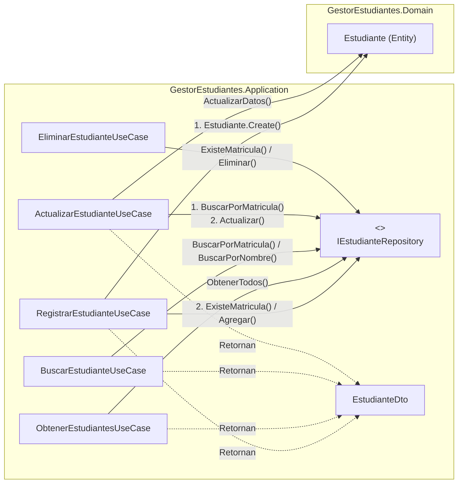

# 10. Fase 3 — Implementación de la Capa Application (`GestorEstudiantes.Application`)

## 1. ¿Qué Responsabilidad Tiene la Capa Application?

En **Clean Architecture** y **Onion Architecture**, la capa **`GestorEstudiantes.Application`** actúa como el **coordinador (u orquestador) de las operaciones del sistema**.

Mientras que `Domain` conoce las reglas internas de un estudiante individual (por ejemplo, que su nombre no esté vacío o que su correo tenga un formato válido), `Application` define **qué acciones puede realizar el usuario en el programa**:
1. Registrar un estudiante nuevo.
2. Consultar la lista completa de estudiantes.
3. Buscar estudiantes por su matrícula o por su nombre.
4. Actualizar la información de un estudiante existente.
5. Eliminar a un estudiante del sistema.

`Application` no sabe cómo se dibujan las ventanas en WPF ni cómo se guardan los datos en la memoria; simplemente coordina el trabajo entre las entidades del dominio (`Estudiante`) y el contrato de almacenamiento (`IEstudianteRepository`).

---

## 2. ¿Qué es `IEstudianteRepository` y Por Qué Está en `Application`?

El archivo [IEstudianteRepository.cs](file:///c:/Users/Jari_/Music/GestorEstudiantesMVVM/GestorEstudiantes.Application/Interfaces/IEstudianteRepository.cs) es una **interfaz** que representa el **Puerto de Salida** en la **Arquitectura Hexagonal (Puertos y Adaptadores)**:

```csharp
public interface IEstudianteRepository
{
    List<Estudiante> ObtenerTodos();
    Estudiante? BuscarPorMatricula(string matricula);
    List<Estudiante> BuscarPorNombre(string nombre);
    void Agregar(Estudiante estudiante);
    void Actualizar(Estudiante estudiante);
    void Eliminar(string matricula);
    bool ExisteMatricula(string matricula);
}
```

### ¿Por qué vive en `Application` y no en `Infrastructure`?
En una programación tradicional, la capa de negocio depende directamente de la base de datos o de la lista en memoria. En cambio, aplicando el **Principio de Inversión de Dependencias (DIP)**:
- `Application` declara la interfaz `IEstudianteRepository` diciendo: *"Para que mis casos de uso funcionen, necesito que alguien me provea estos 7 métodos"*.
- En la Fase 4, la capa `Infrastructure` implementará esa interfaz en una clase concreta (`InMemoryEstudianteRepository`).
- Gracias a que la interfaz está en `Application`, los casos de uso pueden programarse, compilarse y probarse sin que `Infrastructure` esté siquiera implementada todavía.

---

## 3. ¿Para Qué Sirve `EstudianteDto`?

El archivo [EstudianteDto.cs](file:///c:/Users/Jari_/Music/GestorEstudiantesMVVM/GestorEstudiantes.Application/DTOs/EstudianteDto.cs) es un **DTO (*Data Transfer Object* u Objeto de Transferencia de Datos)**.

Contiene únicamente las 5 propiedades de datos simples del estudiante:
- `Matricula`
- `Nombre`
- `Apellido`
- `CorreoElectronico`
- `Carrera`

**¿Por qué usamos un DTO en lugar de enviar la entidad `Estudiante` directamente a la ventana WPF?**
Porque la entidad `Estudiante` de `Domain` protege celosamente su estado interno y sus métodos de negocio. Al devolver un `EstudianteDto` hacia la capa `Presentation` (los futuros ViewModels), entregamos una "fotografía" sencilla de los datos lista para mostrarse en una tabla o formulario sin arriesgar el encapsulamiento del dominio.

---

## 4. ¿Qué Hace Cada Caso de Uso (`UseCases/`)?

Se implementaron cinco clases sencillas y directas en la carpeta `GestorEstudiantes.Application/UseCases/`:



1. **[RegistrarEstudianteUseCase.cs](file:///c:/Users/Jari_/Music/GestorEstudiantesMVVM/GestorEstudiantes.Application/UseCases/RegistrarEstudianteUseCase.cs):**
   - Crea la entidad llamando a `Estudiante.Create(...)` (delegando todas las validaciones de formato y campos obligatorios a `Domain`).
   - Comprueba en el repositorio si la matrícula ya existe (`_repository.ExisteMatricula(...)`). Si ya está registrada, lanza `InvalidOperationException` con un mensaje claro.
   - Guarda el estudiante con `_repository.Agregar(estudiante)` y devuelve el `EstudianteDto` creado.
2. **[ObtenerEstudiantesUseCase.cs](file:///c:/Users/Jari_/Music/GestorEstudiantesMVVM/GestorEstudiantes.Application/UseCases/ObtenerEstudiantesUseCase.cs):**
   - Pide todos los estudiantes a `_repository.ObtenerTodos()`, los transforma en una `List<EstudianteDto>` y los devuelve.
3. **[BuscarEstudianteUseCase.cs](file:///c:/Users/Jari_/Music/GestorEstudiantesMVVM/GestorEstudiantes.Application/UseCases/BuscarEstudianteUseCase.cs):**
   - `BuscarPorMatricula(string matricula)`: Busca un estudiante específico en el repositorio; si existe, lo devuelve como `EstudianteDto`, y si no existe (o la matrícula buscada está vacía), devuelve `null`.
   - `BuscarPorNombre(string nombre)`: Busca todos los estudiantes cuyo nombre coincida y devuelve una `List<EstudianteDto>`.
4. **[ActualizarEstudianteUseCase.cs](file:///c:/Users/Jari_/Music/GestorEstudiantesMVVM/GestorEstudiantes.Application/UseCases/ActualizarEstudianteUseCase.cs):**
   - Busca al estudiante en el repositorio por su matrícula. Si no existe, lanza `InvalidOperationException`.
   - Si existe, invoca `estudiante.ActualizarDatos(nombre, apellido, correoElectronico, carrera)` para que `Domain` valide y modifique los datos conservando la matrícula inmutable.
   - Guarda los cambios con `_repository.Actualizar(estudiante)` y devuelve el `EstudianteDto` actualizado.
5. **[EliminarEstudianteUseCase.cs](file:///c:/Users/Jari_/Music/GestorEstudiantesMVVM/GestorEstudiantes.Application/UseCases/EliminarEstudianteUseCase.cs):**
   - Verifica que la matrícula indicada exista en el repositorio (`_repository.ExisteMatricula(...)`). Si no existe, lanza `InvalidOperationException`.
   - Si existe, lo elimina mediante `_repository.Eliminar(matricula)`.

---

## 5. ¿Cómo se Comprueba la Matrícula Única?

La validación de un registro se divide limpiamente entre `Domain` y `Application` sin duplicar código:
1. Primero, `Estudiante.Create(...)` en `Domain` verifica que la matrícula no esté vacía y le quita los espacios sobrantes (`.Trim()`).
2. Segundo, `RegistrarEstudianteUseCase` en `Application` toma esa matrícula ya limpia y normalizada (`estudiante.Matricula`) y pregunta al puerto `_repository.ExisteMatricula(estudiante.Matricula)`.
3. Si el repositorio responde `true`, el caso de uso impide el registro lanzando `InvalidOperationException("Ya existe un estudiante registrado con la matrícula '...'")`.

---

## 6. Relación de `Application` con `Domain` y Aislamiento respecto a `Infrastructure`

- **Relación con `Domain`:** `Application` conoce y utiliza la clase `Estudiante` y deja que `ValidacionEstudianteException` fluya naturalmente cuando el usuario ingresa datos inválidos, sin reescribir `if` de validación de correo o campos vacíos en los casos de uso.
- **Por qué `Application` no depende de `Infrastructure`:** En [GestorEstudiantes.Application.csproj](file:///c:/Users/Jari_/Music/GestorEstudiantesMVVM/GestorEstudiantes.Application/GestorEstudiantes.Application.csproj), la única referencia es hacia `GestorEstudiantes.Domain`. Esto significa que si mañana decidimos cambiar el almacenamiento en memoria por una base de datos SQL o un archivo JSON, **no habrá que modificar ni una sola línea de `GestorEstudiantes.Application`**.

---

## 7. Ejemplos Sencillos de Uso (Flujo de Registro y Actualización)

### Ejemplo 1: Flujo de Registro de un Estudiante
```csharp
// 1. Se inyecta cualquier implementación de IEstudianteRepository en el caso de uso
var registrarUseCase = new RegistrarEstudianteUseCase(repositorio);

// 2. Se ejecuta el registro
EstudianteDto nuevoEstudiante = registrarUseCase.Ejecutar(
    matricula: "2026-0010",
    nombre: "Carlos",
    apellido: "Mendoza",
    correoElectronico: "carlos.mendoza@universidad.edu",
    carrera: "Ingeniería en Sistemas");

// nuevoEstudiante contiene los datos validados y ya quedó almacenado en el repositorio.
```

### Ejemplo 2: Flujo de Actualización de un Estudiante
```csharp
var actualizarUseCase = new ActualizarEstudianteUseCase(repositorio);

// Se actualizan los datos del estudiante con matrícula "2026-0010"
EstudianteDto estudianteActualizado = actualizarUseCase.Ejecutar(
    matricula: "2026-0010",
    nombre: "Carlos Alberto",
    apellido: "Mendoza Ruiz",
    correoElectronico: "c.mendoza@universidad.edu",
    carrera: "Ingeniería de Software");

// La matrícula "2026-0010" se conserva intacta y los demás datos se actualizan en el repositorio.
```

---

## 8. ¿Cómo se Probaron los Casos de Uso? (`GestorEstudiantes.Application.Tests`)

Para probar todos los casos de uso en la Fase 3 **sin implementar todavía la capa `Infrastructure`** ni instalar librerías complejas de *mocking*, se creó el proyecto de pruebas [GestorEstudiantes.Application.Tests.csproj](file:///c:/Users/Jari_\Music\GestorEstudiantesMVVM\GestorEstudiantes.Application.Tests\GestorEstudiantes.Application.Tests.csproj) con:

1. **[FakeEstudianteRepository.cs](file:///c:/Users/Jari_/Music/GestorEstudiantesMVVM/GestorEstudiantes.Application.Tests/Fakes/FakeEstudianteRepository.cs):** Un repositorio falso muy sencillo exclusivo para las pruebas que implementa `IEstudianteRepository` con una lista interna.
2. **[EstudianteUseCasesTests.cs](file:///c:/Users/Jari_/Music/GestorEstudiantesMVVM/GestorEstudiantes.Application.Tests/UseCases/EstudianteUseCasesTests.cs):** 14 pruebas unitarias con **xUnit** que comprueban todos los escenarios exigidos:
   - **Registro:** Registro válido, rechazo de matrícula duplicada y propagación de `ValidacionEstudianteException` ante datos inválidos.
   - **Consulta y Búsqueda:** Obtener lista con elementos, obtener lista vacía, buscar matrícula existente, buscar matrícula inexistente, buscar por nombre con coincidencias y buscar por nombre sin coincidencias.
   - **Actualización:** Actualizar estudiante existente conservando matrícula, intento de actualizar estudiante inexistente e intento de actualizar con datos inválidos conservando el estado anterior.
   - **Eliminación:** Eliminar estudiante existente e intento de eliminar estudiante inexistente.
