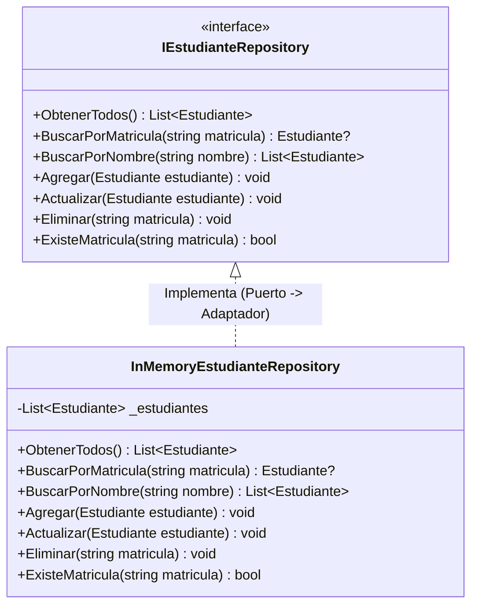

# 12. Fase 4 — Implementación de la Capa Infrastructure (`GestorEstudiantes.Infrastructure`)

## 1. Objetivo de la Capa Infrastructure

En **Clean Architecture**, **Onion Architecture** y **Hexagonal Architecture**, la capa **`GestorEstudiantes.Infrastructure`** se encarga de implementar los **mecanismos técnicos concretos** que el sistema necesita para comunicarse con el mundo exterior (como el almacenamiento de datos), cumpliendo los contratos o puertos definidos previamente por la capa `Application`.

En nuestro proyecto académico **GestorEstudiantesMVVM**, el objetivo de `Infrastructure` es proveer un almacenamiento en memoria sencillo, rápido y sin dependencias de motores de bases de datos externos, de modo que toda la aplicación pueda ejecutarse de inmediato en cualquier computadora con Visual Studio.

---

## 2. Responsabilidad de `InMemoryEstudianteRepository` y Cómo Implementa `IEstudianteRepository`

La clase [InMemoryEstudianteRepository.cs](file:///c:/Users/Jari_/Music/GestorEstudiantesMVVM/GestorEstudiantes.Infrastructure/Repositories/InMemoryEstudianteRepository.cs) es el **Adaptador Secundario (*Driven Adapter*)** que implementa la interfaz (Puerto de Salida) [IEstudianteRepository.cs](file:///c:/Users/Jari_/Music/GestorEstudiantesMVVM/GestorEstudiantes.Application/Interfaces/IEstudianteRepository.cs):

- **Su única responsabilidad** es guardar, buscar, reemplazar y eliminar objetos `Estudiante` dentro de una lista en memoria (`private readonly List<Estudiante> _estudiantes = new();`).
- **No contiene reglas de negocio:** No decide qué formato debe tener un correo ni valida si un nombre es válido, porque eso ya lo garantizan `Domain` y `Application`.

---

## 3. Función de Cada Uno de los Siete Métodos Implementados

1. **`ObtenerTodos()`:**
   - Devuelve una **nueva copia** de la lista (`new List<Estudiante>(_estudiantes)`).
   - *¿Por qué devuelve una copia?* Para proteger la colección original: si alguien fuera del repositorio hiciera `.Clear()` sobre la lista devuelta, la lista interna `_estudiantes` no se vería afectada.
2. **`BuscarPorMatricula(string matricula)`:**
   - Si la matrícula recibida es nula o vacía, devuelve `null`.
   - Busca en `_estudiantes` el primer estudiante cuya `Matricula` coincida (ignorando diferencias entre mayúsculas y minúsculas mediante `StringComparison.OrdinalIgnoreCase`). Si no lo encuentra, devuelve `null`.
3. **`BuscarPorNombre(string nombre)`:**
   - Si el texto buscado es nulo o vacío, devuelve una lista vacía.
   - Filtra todos los estudiantes cuyo `Nombre` o `Apellido` contenga parcialmente el texto buscado (`.Contains(criterio, StringComparison.OrdinalIgnoreCase)`), permitiendo búsquedas flexibles sin importar mayúsculas o minúsculas.
4. **`Agregar(Estudiante estudiante)`:**
   - Verifica que la instancia no sea `null` y la añade a `_estudiantes.Add(estudiante)`.
5. **`Actualizar(Estudiante estudiante)`:**
   - Busca la posición (`FindIndex`) del estudiante dentro de `_estudiantes` usando su `Matricula` inmutable como identificador.
   - Si no existe en la lista (`indice < 0`), lanza un `InvalidOperationException` explícito indicando que no se encontró la matrícula para actualizar.
   - Si existe, actualiza la posición en la lista (`_estudiantes[indice] = estudiante`).
6. **`Eliminar(string matricula)`:**
   - Localiza al estudiante por su matrícula utilizando `BuscarPorMatricula(matricula)`.
   - Si existe en la colección, lo remueve con `_estudiantes.Remove(estudiante)`. Si no existe, termina limpiamente sin producir errores.
7. **`ExisteMatricula(string matricula)`:**
   - Comprueba con `_estudiantes.Any(...)` si ya hay un estudiante con esa matrícula en la lista (ignorando mayúsculas/minúsculas) y devuelve `true` o `false`.

---

## 4. ¿Cómo Funciona el Almacenamiento con `List<Estudiante>` y Por Qué los Datos Desaparecen al Cerrar la Aplicación?

- **Almacenamiento en Memoria RAM:** La colección `private readonly List<Estudiante> _estudiantes = new();` vive exclusivamente en la **memoria RAM** asignada al proceso de la aplicación mientras está abierta.
- **Ciclo de Vida Singleton:** En [InfrastructureServiceRegistration.cs](file:///c:/Users/Jari_/Music/GestorEstudiantesMVVM/GestorEstudiantes.Infrastructure/DependencyInjection/InfrastructureServiceRegistration.cs), el repositorio se registra como `Singleton` (`services.AddSingleton<IEstudianteRepository, InMemoryEstudianteRepository>()`). Esto garantiza que todos los casos de uso compartan la misma lista en memoria mientras el programa esté en ejecución.
- **Volatilidad al Cerrar:** Al no escribirse nada en el disco duro (no hay base de datos SQL ni archivos JSON/XML), cuando el usuario cierra la ventana de la aplicación, el sistema operativo libera la memoria RAM del proceso y la lista desaparece. Al volver a abrir la aplicación, la lista comienza limpia desde cero.

---

## 5. Relación con Clean Architecture, Onion Architecture y Hexagonal Architecture

1. **Hexagonal Architecture (Puertos y Adaptadores):**
   - `IEstudianteRepository` (en `Application`) es el **Puerto de Salida**.
   - `InMemoryEstudianteRepository` (en `Infrastructure`) es el **Adaptador Secundario**.
   - Si en el futuro quisiéramos guardar los datos en SQL Server, solo crearíamos un nuevo adaptador `SqlEstudianteRepository : IEstudianteRepository` en `Infrastructure`, sin cambiar ni una línea de `Domain` ni de `Application`.
2. **Onion Architecture (Arquitectura en Cebolla):**
   - `Infrastructure` está en el anillo exterior y referencia hacia adentro (`Application` y `Domain`). Jamás ocurre lo contrario.
3. **Clean Architecture (Inversión de Dependencias):**
   - Los casos de uso en `Application` nunca hacen `new InMemoryEstudianteRepository()`. Reciben `IEstudianteRepository` por su constructor, manteniendo la lógica de aplicación 100% desacoplada del mecanismo de almacenamiento.

---

## 6. Archivos Creados y Modificados en la Fase 4

### Archivos Modificados
- [InMemoryEstudianteRepository.cs](file:///c:/Users/Jari_/Music/GestorEstudiantesMVVM/GestorEstudiantes.Infrastructure/Repositories/InMemoryEstudianteRepository.cs) — Implementación completa de los 7 métodos de `IEstudianteRepository` sobre `List<Estudiante>`.
- [InfrastructureServiceRegistration.cs](file:///c:/Users/Jari_/Music/GestorEstudiantesMVVM/GestorEstudiantes.Infrastructure/DependencyInjection/InfrastructureServiceRegistration.cs) — Activación del registro `services.AddSingleton<IEstudianteRepository, InMemoryEstudianteRepository>()`.
- [GestorEstudiantesMVVM.sln](file:///c:/Users/Jari_\Music\GestorEstudiantesMVVM\GestorEstudiantesMVVM.sln) — Inclusión del proyecto de pruebas `GestorEstudiantes.Infrastructure.Tests`.

### Archivos Creados
- [GestorEstudiantes.Infrastructure.Tests.csproj](file:///c:/Users/Jari_/Music/GestorEstudiantesMVVM/GestorEstudiantes.Infrastructure.Tests/GestorEstudiantes.Infrastructure.Tests.csproj) — Proyecto de pruebas unitarias para `Infrastructure` con xUnit y `.NET 9.0`.
- [InMemoryEstudianteRepositoryTests.cs](file:///c:/Users/Jari_/Music/GestorEstudiantesMVVM/GestorEstudiantes.Infrastructure.Tests/Repositories/InMemoryEstudianteRepositoryTests.cs) — 14 pruebas unitarias verificando cada método y el estado real de la colección en memoria.
- [12_FASE_4_INFRASTRUCTURE.md](file:///c:/Users/Jari_/Music/GestorEstudiantesMVVM/docs/12_FASE_4_INFRASTRUCTURE.md) — Documentación técnica y didáctica de la Fase 4.

---

## 7. Resultados de Pruebas Unitarias y Compilación

- **`dotnet restore GestorEstudiantesMVVM.sln`:** Restauración completada sin errores.
- **`dotnet test GestorEstudiantesMVVM.sln`:**
  - `GestorEstudiantes.Domain.Tests`: **47 superadas**
  - `GestorEstudiantes.Application.Tests`: **14 superadas**
  - `GestorEstudiantes.Infrastructure.Tests`: **14 superadas**
  - **Total global:** **75 pruebas ejecutadas, 75 superadas, 0 fallidas.**
- **`dotnet build GestorEstudiantesMVVM.sln`:** **`Compilación correcta. 0 Advertencia(s), 0 Errores.`**
