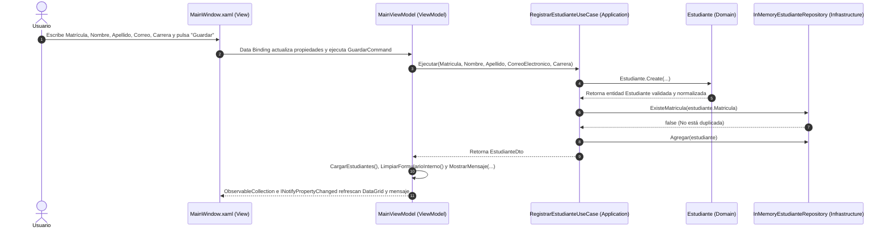

# 13. Fase 5 — Implementación de la Capa Presentation (`GestorEstudiantes.Presentation`)

## 1. Objetivo de la Capa Presentation

La capa **`GestorEstudiantes.Presentation`** es el punto de interacción visual con el usuario final y el **Adaptador Primario (*Driving Adapter*)** de nuestra arquitectura. Construida con **WPF (Windows Presentation Foundation)**, **XAML** y el patrón **MVVM (Model - View - ViewModel)** sobre **.NET 9.0**, su objetivo es:
- Presentar la interfaz gráfica (formulario, tabla `DataGrid`, barra de búsqueda y área de mensajes).
- Capturar las acciones del usuario mediante **Data Binding** y **Commands** (`ICommand`).
- Delegar todas las operaciones del sistema a los Casos de Uso de `GestorEstudiantes.Application` sin contener lógica de negocio propia ni conocer detalles internos del almacenamiento en memoria.
- Actuar como **Composition Root** (en `App.xaml.cs`) para ensamblar la inyección de dependencias al iniciar el programa.

---

## 2. Estructura de Carpetas de `GestorEstudiantes.Presentation`

Se implementó una estructura limpia, minimalista y sin archivos innecesarios:

```text
GestorEstudiantes.Presentation/
│
├── GestorEstudiantes.Presentation.csproj
├── App.xaml
├── App.xaml.cs
│
├── Views/
│   ├── MainWindow.xaml
│   └── MainWindow.xaml.cs
│
├── ViewModels/
│   └── MainViewModel.cs
│
└── Commands/
    └── RelayCommand.cs
```

---

## 3. Responsabilidad de `MainWindow` (View)

El archivo [MainWindow.xaml](file:///c:/Users/Jari_/Music/GestorEstudiantesMVVM/GestorEstudiantes.Presentation/Views/MainWindow.xaml) define exclusivamente la interfaz visual utilizando XAML y una paleta académica limpia (`#0A1D42` azul oscuro, `#00549E` azul principal, `#F4F6F8` fondo neutro y paneles blancos):

1. **Encabezado superior:** Muestra el título *"Gestor de Estudiantes"* y un subtítulo descriptivo.
2. **Sección de búsqueda:** Contiene un `TextBox` enlazado en tiempo real (`UpdateSourceTrigger=PropertyChanged`) a `TextoBusqueda` para filtrar por matrícula, nombre o apellido, junto con un botón *"Limpiar búsqueda"*.
3. **Tabla de estudiantes (`DataGrid`):** Muestra las 5 columnas (`Matrícula`, `Nombre`, `Apellido`, `Correo electrónico`, `Carrera`) enlazada a `EstudiantesView` y sincroniza la fila elegida con `EstudianteSeleccionado`.
4. **Formulario de registro y edición:**
   - Cinco cajas de texto (`Matricula`, `Nombre`, `Apellido`, `CorreoElectronico`, `Carrera`).
   - El campo `Matrícula` enlaza su propiedad `IsEnabled` a `MatriculaHabilitada` (`!EsEdicion`), quedando automáticamente deshabilitado cuando se edita un estudiante existente para proteger la inmutabilidad de la matrícula.
5. **Botones de acción:**
   - **Guardar** (`GuardarCommand`): Registra un estudiante nuevo si `EsEdicion == false`, o actualiza el estudiante seleccionado si `EsEdicion == true`.
   - **Limpiar** (`LimpiarCommand`): Vacía los campos, quita la selección y vuelve al modo de registro.
   - **Eliminar** (`EliminarCommand`): Se habilita únicamente cuando hay un estudiante seleccionado en modo edición y permite eliminarlo.
6. **Barra de mensajes integrada:** Un panel inferior que cambia dinámicamente de estilo (azul informativo o rojo de alerta mediante un `DataTrigger` sobre `EsError`) para mostrar confirmaciones y errores de validación sin abrir ventanas emergentes (`MessageBox`).

El archivo [MainWindow.xaml.cs](file:///c:/Users/Jari_/Music/GestorEstudiantesMVVM/GestorEstudiantes.Presentation/Views/MainWindow.xaml.cs) (*code-behind*) contiene únicamente la inicialización de la ventana y la asignación del `DataContext` recibido por constructor:

```csharp
public partial class MainWindow : Window
{
    public MainWindow(MainViewModel viewModel)
    {
        InitializeComponent();
        DataContext = viewModel;
    }
}
```

---

## 4. Responsabilidad de `MainViewModel` (ViewModel)

La clase [MainViewModel.cs](file:///c:/Users/Jari_/Music/GestorEstudiantesMVVM/GestorEstudiantes.Presentation/ViewModels/MainViewModel.cs) coordina el estado de la interfaz gráfica:

- **Propiedades del formulario y estado:** `Matricula`, `Nombre`, `Apellido`, `CorreoElectronico`, `Carrera`, `TextoBusqueda`, `Mensaje`, `EsError`, `EsEdicion`, `MatriculaHabilitada`, `TituloFormulario` y `EstudianteSeleccionado`.
- **Colección y filtrado en memoria de la vista:**
  - Mantiene `ObservableCollection<EstudianteDto> Estudiantes`.
  - Expone `ICollectionView EstudiantesView` (`CollectionViewSource.GetDefaultView(Estudiantes)`) con el predicado `FiltrarEstudiante`, que busca coincidencias parciales ignorando mayúsculas y minúsculas (`StringComparison.OrdinalIgnoreCase`) en `Matricula`, `Nombre` y `Apellido`.
- **Aislamiento arquitectónico:** `MainViewModel` recibe por constructor los casos de uso de `Application`. No tiene ningún `using GestorEstudiantes.Infrastructure;` ni conoce a `InMemoryEstudianteRepository`.

---

## 5. Funcionamiento de `RelayCommand` (`ICommand`)

En WPF, los botones no deben ejecutar métodos en el archivo `.xaml.cs`, sino enlazar su propiedad `Command` a un objeto que implemente `ICommand`. La clase [RelayCommand.cs](file:///c:/Users/Jari_/Music/GestorEstudiantesMVVM/GestorEstudiantes.Presentation/Commands/RelayCommand.cs) encapsula cualquier método del ViewModel:

```csharp
public class RelayCommand : ICommand
{
    private readonly Action<object?> _execute;
    private readonly Predicate<object?>? _canExecute;

    public RelayCommand(Action<object?> execute, Predicate<object?>? canExecute = null)
    {
        _execute = execute ?? throw new ArgumentNullException(nameof(execute));
        _canExecute = canExecute;
    }

    public event EventHandler? CanExecuteChanged;

    public bool CanExecute(object? parameter) => _canExecute == null || _canExecute(parameter);
    public void Execute(object? parameter) => _execute(parameter);

    public void RaiseCanExecuteChanged() => CanExecuteChanged?.Invoke(this, EventArgs.Empty);
}
```

Por ejemplo, el comando `_eliminarCommand` se define con la condición `_ => EsEdicion && EstudianteSeleccionado != null`. Cuando el usuario selecciona un estudiante en el `DataGrid`, el ViewModel llama a `_eliminarCommand.RaiseCanExecuteChanged()` y WPF activa automáticamente el botón **Eliminar**.

---

## 6. Explicación de `INotifyPropertyChanged`

Para que la ventana XAML se entere de que una variable en C# cambió (por ejemplo, cuando el ViewModel limpia los campos o cambia el texto de `Mensaje`), `MainViewModel` implementa la interfaz `INotifyPropertyChanged`:

```csharp
public event PropertyChangedEventHandler? PropertyChanged;

private void OnPropertyChanged([CallerMemberName] string? propertyName = null)
{
    PropertyChanged?.Invoke(this, new PropertyChangedEventArgs(propertyName));
}
```

El atributo `[CallerMemberName]` rellena automáticamente el nombre de la propiedad que llamó al método, evitando errores de escritura y manteniendo los *setters* limpios.

---

## 7. Explicación de `ObservableCollection<EstudianteDto>`

Una lista normal (`List<EstudianteDto>`) no avisa a la interfaz gráfica cuando se agregan o quitan elementos. En cambio, `ObservableCollection<EstudianteDto>` implementa `INotifyCollectionChanged`: cada vez que `MainViewModel` ejecuta `Estudiantes.Clear()` o `Estudiantes.Add(estudiante)`, el `DataGrid` de WPF se redibuja automáticamente en pantalla.

---

## 8. Funcionamiento del Data Binding

El **Data Binding** (enlace de datos) es el puente declarativo en XAML entre los controles de `MainWindow.xaml` y las propiedades públicas de `MainViewModel`:

- **Enlace de campos de texto (`TwoWay` con actualización inmediata):**
  ```xml
  <TextBox Text="{Binding Nombre, UpdateSourceTrigger=PropertyChanged}" />
  ```
- **Enlace de habilitación de la matrícula:**
  ```xml
  <TextBox Text="{Binding Matricula, UpdateSourceTrigger=PropertyChanged}"
           IsEnabled="{Binding MatriculaHabilitada}" />
  ```
- **Enlace de selección de la tabla (`DataGrid`):**
  ```xml
  <DataGrid ItemsSource="{Binding EstudiantesView}"
            SelectedItem="{Binding EstudianteSeleccionado, Mode=TwoWay}" />
  ```

---

## 9. Conexión con `Application` y Manejo de Excepciones

`MainViewModel` delega cada acción del usuario en el caso de uso correspondiente y captura las excepciones de negocio (`DomainException` e `InvalidOperationException`) para presentarlas amigablemente en la barra de estado:

```csharp
try
{
    if (!EsEdicion)
    {
        var registrado = _registrarEstudianteUseCase.Ejecutar(
            Matricula, Nombre, Apellido, CorreoElectronico, Carrera);

        CargarEstudiantes();
        LimpiarFormularioInterno();
        MostrarMensaje($"Estudiante con matrícula '{registrado.Matricula}' registrado correctamente.", esError: false);
    }
    else
    {
        var matriculaOriginal = EstudianteSeleccionado!.Matricula;
        var actualizado = _actualizarEstudianteUseCase.Ejecutar(
            matriculaOriginal, Nombre, Apellido, CorreoElectronico, Carrera);

        CargarEstudiantes();
        LimpiarFormularioInterno();
        MostrarMensaje($"Datos del estudiante '{actualizado.Matricula}' actualizados correctamente.", esError: false);
    }
}
catch (DomainException ex)
{
    MostrarMensaje(ex.Message, esError: true);
}
catch (InvalidOperationException ex)
{
    MostrarMensaje(ex.Message, esError: true);
}
```

---

## 10. Composition Root e Inyección de Dependencias (`App.xaml.cs`)

El archivo [App.xaml.cs](file:///c:/Users/Jari_/Music/GestorEstudiantesMVVM/GestorEstudiantes.Presentation/App.xaml.cs) es el **Composition Root** (Raíz de Composición). Al no existir `StartupUri` en [App.xaml](file:///c:/Users/Jari_/Music/GestorEstudiantesMVVM/GestorEstudiantes.Presentation/App.xaml), existe un único mecanismo limpio de inicio:

```csharp
private static void ConfigureServices(IServiceCollection services)
{
    // 1. Registra IEstudianteRepository -> InMemoryEstudianteRepository como Singleton
    services.AddInfrastructureServices();

    // 2. Registra los 5 casos de uso de Application
    services.AddTransient<RegistrarEstudianteUseCase>();
    services.AddTransient<ObtenerEstudiantesUseCase>();
    services.AddTransient<BuscarEstudianteUseCase>();
    services.AddTransient<ActualizarEstudianteUseCase>();
    services.AddTransient<EliminarEstudianteUseCase>();

    // 3. Registra MainViewModel y MainWindow
    services.AddTransient<MainViewModel>();
    services.AddTransient<MainWindow>();
}
```

Cuando `OnStartup` solicita `ServiceProvider.GetRequiredService<MainWindow>()`, el contenedor resuelve automáticamente toda la cadena de dependencias: crea la única instancia en memoria de `InMemoryEstudianteRepository`, la inyecta en los 5 casos de uso, inyecta los 5 casos de uso en `MainViewModel`, e inyecta `MainViewModel` en `MainWindow`.

---

## 11. Flujo Completo de una Operación (De Extremo a Extremo)



---

## 12. Integración de MVVM con Clean, Onion y Hexagonal Architecture

- **MVVM** gobierna la estructura interna de `Presentation` (`MainWindow` <--> `MainViewModel` + `RelayCommand`).
- **Hexagonal Architecture** conecta `MainViewModel` (Adaptador Primario) con los Casos de Uso de `Application`, y conecta `IEstudianteRepository` (Puerto de Salida) con `InMemoryEstudianteRepository` (Adaptador Secundario).
- **Onion Architecture y Clean Architecture** aseguran que todas las dependencias apunten hacia el núcleo (`Domain`), manteniendo las reglas de negocio aisladas de WPF y de la lista en memoria.

---

## 13. Pruebas Realizadas y Resultados

1. **Pruebas Unitarias Automatizadas (`dotnet test`):**
   - `GestorEstudiantes.Domain.Tests`: **47 superadas**
   - `GestorEstudiantes.Application.Tests`: **14 superadas**
   - `GestorEstudiantes.Infrastructure.Tests`: **14 superadas**
   - **Total:** **75/75 pruebas superadas sin regresiones.**
2. **Verificación de Ejecución y Flujos del ViewModel:**
   - Se verificó la compilación limpia de `GestorEstudiantes.Presentation` (`0 advertencias, 0 errores`) y el arranque real del ejecutable WPF (`GestorEstudiantes.Presentation.exe`), comprobando que el *Composition Root* (`App.xaml.cs`) construye el grafo completo de dependencias y levanta `MainWindow` sin errores en tiempo de ejecución.

---

## 14. Archivos Creados y Modificados en la Fase 5

### Archivos Modificados en `GestorEstudiantes.Presentation`
- [RelayCommand.cs](file:///c:/Users/Jari_/Music/GestorEstudiantesMVVM/GestorEstudiantes.Presentation/Commands/RelayCommand.cs)
- [MainViewModel.cs](file:///c:/Users/Jari_/Music/GestorEstudiantesMVVM/GestorEstudiantes.Presentation/ViewModels/MainViewModel.cs)
- [MainWindow.xaml](file:///c:/Users/Jari_/Music/GestorEstudiantesMVVM/GestorEstudiantes.Presentation/Views/MainWindow.xaml)
- [App.xaml](file:///c:/Users/Jari_/Music/GestorEstudiantesMVVM/GestorEstudiantes.Presentation/App.xaml)
- [App.xaml.cs](file:///c:/Users/Jari_/Music/GestorEstudiantesMVVM/GestorEstudiantes.Presentation/App.xaml.cs)
- [GestorEstudiantes.Presentation.csproj](file:///c:/Users/Jari_/Music/GestorEstudiantesMVVM/GestorEstudiantes.Presentation/GestorEstudiantes.Presentation.csproj)

### Archivos Creados
- [13_FASE_5_PRESENTATION.md](file:///c:/Users/Jari_/Music/GestorEstudiantesMVVM/docs/13_FASE_5_PRESENTATION.md)
